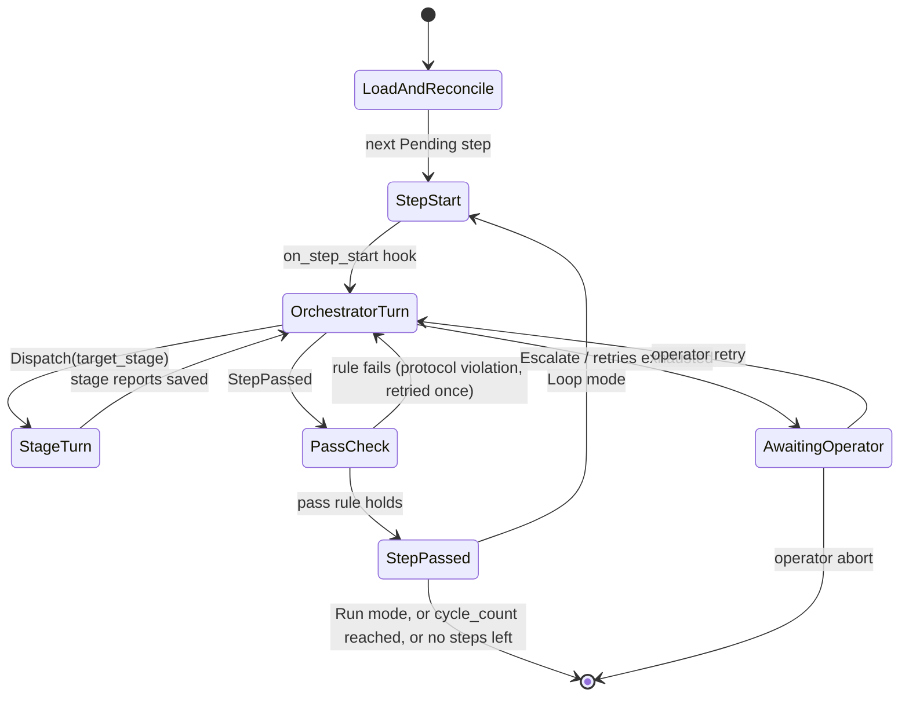

# Orrery — Technical Specification

> **Source of truth.** This spec is authoritative. §9 is the binding interface reference: exact signatures and algorithms the plan steps implement as written. `STEPPED_IMPLEMENTATION_PLAN.md` references its sections by number and must not restate or change any type, field or function defined here. If the plan and this spec disagree, this spec wins; stop and report the conflict.
>
> Product intent and recorded decisions: `Orrery_Initial.md` (see its "Decisions" section).

## 1. Summary

**Orrery** is a Rust CLI + TUI that stages and runs multi-agent LLM workflows. It ingests a stepped implementation plan written in Markdown, and for each plan step drives a workflow of **stages** (columns): a single **Orchestrator** stage, one or more implementation stages, and usually a **Validator** stage. Orrery enforces per-role guardrails, mediates MCP tool access, manages local container/model resources, and checkpoints every transition to disk as validated TOML.

Orrery **only orchestrates**. Version control, builds and similar actions are performed by MCP tools (e.g. Nebulous, a git MCP server) that Orrery calls at configured lifecycle hooks. The core is **domain-neutral**: software development is the first use case, but no role names, tool names or language toolchains are hardcoded in `orrery-core`. They live in role/template data.

### 1.1 Terminology

| Term | Meaning |
|---|---|
| **Plan step** | One section of the implementation plan Markdown, found by the step marker (§5.4). |
| **Stage** | One workflow column: a role plus 1..=15 agents. A workflow has 2..=15 stages. |
| **Round** | One orchestrator turn plus the stage turn it dispatches. |
| **Cycle count** | In Loop mode, the number of plan steps that must pass before stopping. `0` = until out of plan steps. Ignored in Run mode. |
| **Gate** | An ordered list of MCP tools Orrery runs itself (no LLM) to check a plan step, e.g. a test runner. |
| **Operator** | The human running Orrery. |

---

## 2. Core Principles

1. **CLI + TUI parity.** `orrery` or `orrery [PATH]` (no subcommand) launches the TUI for `PATH` (default `.`). `orrery <SUBCOMMAND>` runs headless. Every TUI action has a CLI equivalent (§7). The reverse is not required.
2. **Three agent backends** (§4.3), any role may use any backend:
   - `LocalModel` — an OpenAI-compatible chat endpoint served locally (primary target: a llama.cpp `llama-server` the operator already runs, single-model or router mode). Orrery runs the tool loop.
   - `AgentCli` — a containerized agent CLI (e.g. Claude Code, Gemini CLI) run non-interactively. The CLI runs its own tool loop.
   - `CloudApi` — a remote OpenAI-compatible chat endpoint. Orrery runs the tool loop.
   - The default 3-stage template assigns local models to implementation and a stronger backend to orchestrator and validator.
3. **Resource management.**
   - Agents from different stages never run at the same time.
   - Within a stage, up to `max_concurrent_agents` run in parallel, except **writer stages** (§5.10.3), which run one agent at a time unless the orchestrator assigns disjoint write scopes.
   - Orrery attaches to the operator's existing model servers. Between stages it frees what the next stage doesn't need: unload through the router API, or stop a single-model server Orrery itself started (§9.6, §9.6a). It never creates or configures model servers.
4. **Zero-footprint secrets.** API keys live only in the OS keychain (§5.3). Configs reference them by `(keychain_service, keychain_account)`. In memory they are `SecretValue` (zeroized on drop, redacted on format). Every stream event and log line passes through `SecretRedactor`.
5. **Indirect agent communication via validated reports.** Each agent turn starts from a fresh context. Agents return a structured report (§5.5); Orrery validates it, stamps the fields it already knows, and persists it atomically as TOML in `.orrery/checkpoints/`. Interrupted runs resume from the last checkpoint.
6. **Deterministic pass rule.** A plan step passes only when Orrery's own rule says so (§5.10.2). The orchestrator cannot override a validator denial or a failed gate.
7. **Central MCP gatekeeper.** For `LocalModel` and `CloudApi` agents, Orrery is the only MCP client. Tools shown to an agent are filtered by the role's allowlist, and every call is re-checked before it reaches a transport (§5.8). For `AgentCli` agents, guardrails come from the CLI's own tool configuration plus container isolation and mounts; the MCP gatekeeper does **not** cover a CLI's built-in tools (§5.7.2).
8. **Isolated live stream.** Agent output streams to the TUI and to `.orrery/logs/`. It is never fed back into any agent prompt or exposed through any tool.

---

## 3. Workspace & Dependencies

Resolver 3, edition 2024, `rust-version` = installed stable toolchain at Step 1.

```text
Orrery/
├── Cargo.toml                        # Workspace manifest, [workspace.dependencies], [workspace.lints]
├── Cargo.lock                        # Committed
├── deny.toml                         # cargo-deny policy (§8)
├── Orrery_Initial.md
├── ORRERY_TECHNICAL_SPECIFICATION.md
├── STEPPED_IMPLEMENTATION_PLAN.md
└── crates/
    ├── orrery-core/src/
    │   ├── lib.rs           # Module exports, Error, Result
    │   ├── config.rs        # Project/Role/Agent/MCP models, ConfigStore
    │   ├── security.rs      # SecretValue, SecretStore, SecretRedactor
    │   ├── plan.rs          # Plan step parser
    │   ├── checkpoint.rs    # Reports, WorkflowCheckpoint, CheckpointManager
    │   ├── stream_log.rs    # LiveStreamHub, rotating log
    │   ├── docker.rs        # ContainerBackend, ResourceManager
    │   ├── mcp.rs           # McpTransport, McpGatekeeper
    │   ├── llm.rs           # Prompt builders, AgentDriver implementations
    │   └── engine.rs        # Workflow state machine
    ├── orrery-tui/src/
    │   ├── lib.rs           # Exports, run_tui
    │   ├── theme.rs         # Nebulous palette, banner
    │   ├── layout.rs        # UiLayoutRegions
    │   ├── app.rs           # App state, AppAction, input handling
    │   ├── widgets.rs       # Leaf widget rendering
    │   └── bridge.rs        # Engine ↔ TUI channel wiring
    └── orrery-cli/src/
        ├── main.rs          # Entry point
        ├── args.rs          # clap definitions
        └── commands.rs      # Command handlers
```

### 3.1 Dependencies

Versions and features below were resolved together, built, and checked with `cargo deny` on 2026-11-12 (latest stable releases at that date). Plan steps add each crate with exactly this line; they do not look up versions or feature names. Never edit `Cargo.lock` by hand.

| Crate | `[workspace.dependencies]` line | Purpose / constraints | Added in |
|---|---|---|---|
| `thiserror`, `serde`, `serde_json`, `toml`, `tempfile`, `dirs` | already present | Errors, configs, fixtures, XDG paths. `deny_unknown_fields` on every on-disk struct | Steps 1–3 |
| `secrecy` | `secrecy = "0.10.3"` | `SecretString` | Step 4 |
| `zeroize` | `zeroize = "1.9.1"` | Secret memory hygiene | Step 4 |
| `keyring-core` | `keyring-core = "1.0.1"` | Credential-store API (`Entry`, `CredentialStore`, `Error`) | Step 4 |
| `dbus-secret-service-keyring-store` | `dbus-secret-service-keyring-store = { version = "1.0.1", features = ["crypto-rust"] }` | Secret Service via libdbus. Build host needs `libdbus-1-dev` + `pkg-config`. **Not** the zbus store: zbus 5 pulls `zvariant`/`zbus_names`, flagged unmaintained (RUSTSEC-2026-0370/0371/0372) | Step 4 |
| `linux-keyutils-keyring-store` | `linux-keyutils-keyring-store = "1.0.0"` | Kernel keyutils fallback | Step 4 |
| `sha2` | `sha2 = "0.11.1"` | FIPS 180-4 SHA-256. Hex encoding is hand-written (no `hex` crate: last release 2021) | Step 6 |
| `jiff` | `jiff = { version = "1.0.1", default-features = false, features = ["std", "serde"] }` | Timestamps: `jiff::Timestamp` (UTC instant, RFC 3339 with `Z` on the wire). Replaced chrono in Step 84 | Step 7 |
| `uuid` | `uuid = { version = "1.29.2", features = ["v4", "serde"] }` | Run IDs | Step 8 |
| `tokio` | `tokio = { version = "1.54.1", features = ["sync"] }` — features grow per step (§3.2) | Runtime | Step 9 |
| `async-trait` | `async-trait = "0.1.92"` | `dyn`-compatible async traits (native `async fn` in traits is not `dyn`-compatible) | Step 10 |
| `reqwest` | `reqwest = { version = "0.13.5", default-features = false, features = ["rustls", "json", "stream"] }` | HTTP. `rustls` uses aws-lc-rs. No `openssl-sys` | Step 11 |
| `rmcp` | `rmcp = { version = "3.9.0", default-features = false, features = ["client", "transport-child-process", "transport-streamable-http-client-reqwest", "reqwest"] }` | MCP client | Step 11 |
| `futures-util` | `futures-util = "0.3.34"` | `StreamExt`, `join_all` | Step 15 |
| `bollard` | `bollard = "0.21.1"` | Docker Engine API (default features `http`, `pipe`) | Step 15 |
| `tokio-util` | `tokio-util = "0.7.20"` | `CancellationToken` (no features needed) | Step 20 |
| `ratatui` | `ratatui = "0.30.2"` | TUI | Step 27 |
| `crossterm` | `crossterm = { version = "0.29.0", features = ["event-stream"] }` | Terminal I/O, `EventStream` | Step 27 |
| `clap` | `clap = { version = "4.6.7", features = ["derive"] }` | CLI | Step 33 |
| `rpassword` | `rpassword = "7.5.5"` | No-echo secret prompt for `orrery secret set` | Step 35 |

There is no `keyring` facade crate: `keyring` 4.x's `v1::Entry` hard-codes the zbus store and has no keyutils fallback, and 3.x is an older release (not permitted).

### 3.2 `tokio` features by step

The workspace line's `features` list is replaced (not appended) at these steps:

| Step | `features = [...]` |
|---|---|
| 9 | `["sync"]` |
| 10 | `["sync", "macros", "rt"]` |
| 11 | `["sync", "macros", "rt", "process", "io-util", "time"]` |
| 33 | `["sync", "macros", "rt", "rt-multi-thread", "process", "io-util", "time", "signal"]` |

---

## 4. On-Disk Layout & Schemas

```text
~/.config/orrery/                 # Global catalog (optional). Project files override by id.
├── roles/<role_id>.toml + .md
├── agents/<agent_id>.toml
└── mcp/servers.toml

<project_root>/.orrery/
├── project.toml
├── roles/<role_id>.toml + .md
├── agents/<agent_id>.toml
├── mcp/servers.toml
├── checkpoints/
│   ├── workflow_state.toml                       # WorkflowCheckpoint
│   └── step_001/round_02_stage_01_<agent_id>.toml # StampedReport
├── agent_io/<run_id>/<agent_id>/                 # AgentCli mounts: in/ (ro), out/ (rw), mask/ (empty, ro over /workspace/.orrery). Deleted after the stage.
└── logs/live_stream.log, .log.1, .log.2
```

All on-disk writes are atomic (write temp file in the same directory, `fsync`, rename).

### 4.1 `project.toml` — `ProjectConfig`

```toml
project_name = "my-service"
plan_path = "STEPPED_IMPLEMENTATION_PLAN.md"
step_marker = "## Step "          # Line prefix that starts a plan step (§5.4)
execution_mode = "Run"            # "Run" | "Loop"
cycle_count = 0                   # Loop only: plan steps to pass. 0 = until out of steps
max_concurrent_agents = 2         # Upper bound for parallel agents within one stage
max_step_retries = 3              # Validator/gate failures per plan step before escalating to the operator
validation_mode = "Auto"          # "Auto" | "Agents" | "GateAndOperator" (§5.10.2)
gate_tools = []                   # Ordered MCP tools run by Orrery, e.g. ["cargo:test"]

[[stages]]
role_id = "orchestrator"
agent_ids = ["cloud-orchestrator"]

[[stages]]
role_id = "coder"
agent_ids = ["local-coder"]

[[stages]]
role_id = "validator"
agent_ids = ["cloud-validator"]

[hooks]                           # Optional. Each names an MCP tool (§5.10.4)
on_step_start = { tool = "git:create_branch", on_failure = "Halt" }
on_step_pass  = { tool = "git:commit", on_failure = "Halt" }
on_step_retry = { tool = "git:restore", on_failure = "Warn" }
on_halt       = { tool = "git:stash", on_failure = "Warn" }
```

Stage index = position in `stages` (0-based). There is no separate `column_index` field.

**`ProjectConfig::validate(&self, roles, agents) -> Result<()>` invariants:**
- `stages.len()` in `2..=15`. `ProjectConfig::default_template` produces 3 stages.
- **Exactly one** stage has an orchestrator role, and it is stage 0. It has exactly 1 agent when running (0 allowed while staging).
- Every other stage has `0..=15` agents while staging and `1..=15` when running (`validate_for_run`).
- Every referenced `role_id` / `agent_id` exists.
- `step_marker` is non-empty and contains at least one non-whitespace character.
- `plan_path` resolves inside `project_root` (no `..`, no symlink escape).
- `validation_mode` resolution (`ProjectConfig::effective_validation_mode`): `Auto` → `Agents` if any stage's role has `is_validator = true`, otherwise `GateAndOperator`.
- `GateAndOperator` with empty `gate_tools` is allowed (operator-only validation) but `validate` returns a warning list that the CLI/TUI shows.
- `max_concurrent_agents >= 1`. `[limits]` per §9.11.2 (amended).

### 4.2 Roles — `roles/<role_id>.toml` + `.md`

```toml
role_id = "coder"
display_name = "Implementation"
kind = "Implementer"              # "Orchestrator" | "Implementer" | "Validator"
rules_file = "coder.md"           # Markdown appended to the system prompt
allowed_mcp_tools = ["filesystem:read_file", "filesystem:write_file", "cargo:check"]
```

`RoleConfig` exposes `is_orchestrator()` / `is_validator()` derived from `kind` (one field, no conflicting booleans). A role is a **writer** if any of its allowed tools is listed in a server's `write_tools` (§4.4), or if any of its agents uses `AgentCli` with `workspace_mount = "ReadWrite"`.

### 4.3 Agents — `agents/<agent_id>.toml`

Common fields: `agent_id`, `display_name`, `[backend]`.

```toml
# LocalModel — served by an inference server the operator already runs
agent_id = "local-coder"
display_name = "Local Coder"
[backend]
type = "LocalModel"
inference_id = "coder-14b"         # Refers to [[inference]] in project.toml or global config
model = "Qwen2.5-Coder-14B-Instruct-Q4_K_M"  # Router mode: an id from GET /v1/models. Single mode: informational
temperature = 0.1
max_context_tokens = 32768
```

```toml
# AgentCli — one container per agent per stage, removed afterwards
agent_id = "cli-validator"
display_name = "CLI Validator"
[backend]
type = "AgentCli"
image = "registry.example.com/agents/claude-code@sha256:<digest>"  # Digest or exact tag; never `latest`
command = ["claude", "-p", "--output-format", "stream-json"]       # Prompt is passed on stdin
workspace_mount = "ReadOnly"       # "None" | "ReadOnly" | "ReadWrite"
memory_limit_mb = 4096
timeout_secs = 1800
keychain_service = "orrery.agent.cli-validator"   # Optional; injected as env var below
keychain_account = "testuser"
secret_env = "ANTHROPIC_API_KEY"
```

```toml
# CloudApi
agent_id = "cloud-validator"
display_name = "Cloud Validator"
[backend]
type = "CloudApi"
endpoint_url = "https://api.example.com/v1/chat/completions"
model = "example-model"
temperature = 0.0
max_context_tokens = 65536
keychain_service = "orrery.agent.cloud-validator"
keychain_account = "testuser"
```

Inference servers (`[[inference]]` in `project.toml` or global `inference.toml`). These describe servers the operator already runs; see §9.6a for every field.

```toml
# Single-model llama-server in an existing container
[[inference]]
inference_id = "coder-14b"
endpoint_url = "http://127.0.0.1:8080"
mode = "Single"                    # "Single" (default) | "Router"
lifecycle = { type = "Container", name = "llama-coder-14b" }
unload_after_stage = true          # Default true: stop it before a stage that doesn't use it (only if Orrery started it)
```

```toml
# Router-mode llama-server defined in a compose file
[[inference]]
inference_id = "router"
endpoint_url = "http://127.0.0.1:8081"
mode = "Router"
lifecycle = { type = "Compose", file = "docker-models/router/compose.yaml", service = "llama" }
```

```toml
# Already running; Orrery only talks HTTP
[[inference]]
inference_id = "always-on"
endpoint_url = "http://127.0.0.1:8082"
lifecycle = { type = "External" }
```

`AgentConfig::validate_no_embedded_secrets` rejects any field value matching common key shapes (`sk-`, `Bearer `, `AIza`, `ghp_`, `xox`). This is defense in depth, not the primary control.

### 4.4 MCP servers — `mcp/servers.toml`

```toml
[[servers]]
server_id = "filesystem"
transport = { type = "Stdio", command = "mcp-filesystem", args = ["--root", "."] }
write_tools = [{ tool = "write_file", path_args = ["path"] }]   # Marks writer tools and which args are paths

[[servers]]
server_id = "remote"
transport = { type = "StreamableHttp", endpoint_url = "https://mcp.example.com/mcp", keychain_service = "orrery.mcp.remote", keychain_account = "testuser" }
```

---

## 5. Components (`orrery-core`)

### 5.1 `lib.rs` — Errors

```rust
#[derive(Debug, thiserror::Error)]
pub enum Error {
    #[error("I/O error at {path}")] Io { path: PathBuf, #[source] source: std::io::Error },
    #[error("TOML parse error in {path}")] TomlDe { path: PathBuf, #[source] source: toml::de::Error },
    #[error(transparent)] TomlSer(#[from] toml::ser::Error),
    #[error(transparent)] Json(#[from] serde_json::Error),
    #[error("path escapes project: {path}")] PathTraversal { path: PathBuf },
    #[error("invalid {field}: {message}")] Validation { field: String, message: String },
    #[error("security violation: {message}")] Security { message: String },
    #[error("keychain error")] Keychain(#[source] keyring_core::Error),
    #[error("plan parse error at line {line}: {message}")] PlanParse { line: usize, message: String },
    #[error("invalid agent report: {message}")] Report { message: String },
    #[error("docker error")] Docker(#[source] bollard::errors::Error),
    #[error("MCP error on {server_id}")] Mcp { server_id: String, #[source] source: Box<dyn std::error::Error + Send + Sync> },
    #[error("agent {agent_id} failed: {message}")] Agent { agent_id: String, message: String },
    #[error("HTTP error")] Http(#[source] reqwest::Error),
    #[error("plan step {step_number}: {message}")] Engine { step_number: usize, message: String },
    #[error("interrupted")] Interrupted,
}
pub type Result<T> = std::result::Result<T, Error>;
```

Variants that wrap a crate's error are added in the step that adds that crate. No `.unwrap()`/`.expect()` outside tests.

### 5.2 `config.rs`

- Types: `ExecutionMode { Run, Loop }`, `ValidationMode { Auto, Agents, GateAndOperator }`, `StageConfig { role_id, agent_ids }`, `HookEvent { StepStart, StepPass, StepRetry, Halt }`, `HookConfig { tool, on_failure: HookFailure { Halt, Warn } }`, `ProjectConfig`, `RoleKind`, `RoleConfig`, `AgentBackend { LocalModel{..}, AgentCli{..}, CloudApi{..} }`, `AgentConfig`, `InferenceConfig`, `McpTransportConfig { Stdio{..}, StreamableHttp{..} }`, `WriteToolSpec { tool, path_args }`, `McpServerConfig`, `ConfigStore`.
- `ProjectConfig::default_template(project_name) -> Self`
- `ProjectConfig::validate(&self, roles, agents) -> Result<Vec<Warning>>`, `validate_for_run(..)`, `effective_validation_mode(&self, roles) -> ValidationMode`
- `ProjectConfig::set_stage_count(&mut self, count) -> Result<()>` — grows with empty implementer stages; shrinking removes trailing stages; never removes stage 0.
- `ProjectConfig::set_stage_role(&mut self, index, role_id)`, `assign_agent(&mut self, index, agent_id)`, `remove_agent(&mut self, index, agent_id)`, `clear_stage(&mut self, index)` — each re-validates staging invariants.
- `AgentConfig::validate_no_embedded_secrets(&self) -> Result<()>`
- `ConfigStore::new(project_root, xdg_override: Option<PathBuf>) -> Result<Self>`, `init_project(name)`, `resolve_safe_path(rel)`, `load_project`/`save_project`, `load_roles`/`save_role`/`remove_role`, `load_agents`/`save_agent`/`remove_agent`, `load_mcp_servers`/`save_mcp_server`/`remove_mcp_server`, `load_inference`.
- Layering: global catalog loaded first; project entries with the same id replace (not merge) global ones.

### 5.3 `security.rs`

- `SecretValue(secrecy::SecretString)`; `Debug`/`Display` print `[REDACTED]`; `SecretValue::expose(&self) -> &str` is `pub(crate)` and used only by HTTP auth and AgentCli env injection.
- `trait SecretStore: Send + Sync { set, get, delete }` with `OsKeyringStore` and `InMemorySecretStore` (tests).
- **Headless policy:** `OsKeyringStore` tries Secret Service first (`dbus_secret_service_keyring_store::Store::new()`); if that fails (no D-Bus session), it uses kernel keyutils (`linux_keyutils_keyring_store::Store::new()`), which does not survive reboot — the CLI tells the operator to re-run `orrery secret set`. If neither is available, return `Error::Keychain`. There is no file or env-var fallback.
- `SecretRedactor`: `register(&self, &SecretValue)`, `redact(&self, &str) -> String`. Replaces registered secrets (len ≥ 8) and patterns `Bearer \S+`, `sk-[A-Za-z0-9_-]{8,}`, `AIza[0-9A-Za-z_-]{20,}`, `ghp_[A-Za-z0-9]{20,}` with `[REDACTED]`. Pattern matching is hand-written (no regex dependency).

### 5.4 `plan.rs` — Plan Step Parser

- `PlanStep { index: usize, number: usize, title: String, body: String, sha256_hex: String }` — hash over `title + "\n" + body` with line endings normalized to `\n`.
- `ImplementationPlan { source_path: Option<PathBuf>, step_marker: String, preamble: String, steps: Vec<PlanStep> }`
- `ImplementationPlan::parse(markdown, step_marker) -> Result<Self>`:
  - Tracks fenced code blocks (```` ``` ```` and `~~~`, matching fence character and minimum length per CommonMark). Marker lines inside fences are ignored.
  - Outside fences, a line starting with `step_marker` begins a step; `title` is the rest of the line, trimmed.
  - Text before the first marker is `preamble`.
  - Errors: empty marker, zero steps, unclosed fence at EOF (`PlanParse` with line number).
  - If titles begin with a number (`1:`, `1.`, `1 `), numbers must be contiguous starting at 1; otherwise `PlanParse`.
- `ImplementationPlan::from_file(path, step_marker)`, `plan_sha256(&self)`.
- **Acceptance fixture:** parsing `STEPPED_IMPLEMENTATION_PLAN.md` with marker `### STEP ` yields exactly the plan's step count (51, numbered 1..=51). That marker is specific to Orrery's own plan, whose headings follow the Nebulous format; the product default `step_marker` stays `"## Step "` (§4.1).

### 5.5 `checkpoint.rs` — Reports & State

**What the agent submits** (`AgentReport`, `deny_unknown_fields`):
- `status: ReportStatus` — per role kind:
  - Orchestrator: `Dispatch` | `StepPassed` | `Escalate`
  - Implementer: `Complete` | `Blocked`
  - Validator: `Confirmed` | `Denied`
- `summary: String` (non-empty, ≤ 4 KiB)
- `target_stage: Option<usize>` — required for `Dispatch`
- `allocations: Vec<SubtaskAllocation>` — required non-empty for `Dispatch`; `SubtaskAllocation { target_agent_id, instructions, write_scope: Vec<String> }` (`write_scope` = relative path prefixes)
- `feedback: Option<String>` — required for `Denied`, `Blocked`, `Escalate`
- `artifacts: Vec<String>` — paths or refs the agent produced/touched

**What Orrery stamps** (`StampedReport { report: AgentReport, step_number, plan_step_sha256, round, stage_index, role_id, agent_id, recorded_at }`). Agents never supply these.

**How reports arrive:**
- `LocalModel` / `CloudApi`: the agent calls a synthetic `submit_report` function tool whose JSON schema is generated from `AgentReport`. A turn that ends without a valid `submit_report` call is re-prompted once with the validation error, then fails (`Error::Report`).
- `AgentCli`: the agent writes `/orrery/out/report.toml` (path given in its prompt). Same schema, same validation, same single re-prompt.

**Functions:**
- `AgentReport::validate_for_role(&self, role: &RoleConfig, stage_count: usize) -> Result<()>`
- `report_json_schema() -> serde_json::Value` — hand-built JSON Schema for the `submit_report` tool; required fields must match `AgentReport`.
- `WorkflowCheckpoint { run_id, plan_sha256, step_hashes: Vec<String>, step_statuses: Vec<StepStatus>, current_step_index, round, active_stage_index, retry_count, steps_passed_this_run, phase: EnginePhase, hook_results: Vec<HookResult> }`; `StepStatus { Pending, InProgress, Passed, AwaitingOperator, Failed }`.
- `CheckpointManager::new(dir)`, `save_state`, `load_state -> Option<_>`, `save_report(&StampedReport) -> PathBuf`, `load_reports(step_number, round: Option<usize>)`.
- **Plan-edit policy** (`WorkflowCheckpoint::reconcile(&self, plan) -> Result<ReconcileOutcome>`): if any `Passed` or the current step's hash changed → `Error::Engine` (operator must `orrery reset --step N`). Changes to later steps, or appended steps, are accepted and the stored hashes updated.

### 5.6 `stream_log.rs` — Live Stream

- `StreamEventKind { Output, Reasoning, SystemNotice, ToolCall, ReportSaved, GateResult, Error }`; `StreamEvent { timestamp, step_number, stage_index, agent_id, kind, text }`.
- `LiveStreamConfig { ring_capacity: 2_000, max_file_bytes: 10 MiB, max_files: 3 }`.
- `LiveStreamHub::new(log_dir, config, Arc<SecretRedactor>)`; `emit(&self, event)` redacts, pushes to the ring buffer (evicting oldest), appends to `live_stream.log`, rotates `.log → .log.1 → .log.2` (oldest dropped) **before** a write would exceed `max_file_bytes`; `subscribe(&self) -> tokio::sync::broadcast::Receiver<StreamEvent>`; `recent(&self, limit)`.
- Interior mutability (`Mutex` held only for non-async sections); the hub is shared as `Arc<LiveStreamHub>`. (amended: §9.11.4, file IO on a writer thread)
- Invariant: total log bytes ≤ `max_file_bytes * max_files`.
- `Reasoning` events appear only when a backend exposes reasoning tokens.

### 5.7 `docker.rs` — Containers & Resources

- `#[async_trait] trait ContainerBackend: Send + Sync`:
  - `start(&self, name: &str) -> Result<()>` (existing containers only; §9.6)
  - `stop(&self, name: &str) -> Result<()>`
  - `remove(&self, name: &str) -> Result<()>`
  - `inspect(&self, name: &str) -> Result<ContainerState>`
  - `run_to_completion(&self, spec: &ContainerSpec, stdin: Vec<u8>, on_output: &(dyn Fn(String) + Send + Sync)) -> Result<ExitStatus>` (AgentCli)
- `ContainerSpec { name, image, cmd, env: Vec<(String, EnvValue)>, mounts: Vec<MountSpec>, memory_limit_mb, auto_remove: bool }` (AgentCli containers only); `EnvValue::{Plain(String), Secret(SecretValue)}`.
- `BollardContainerBackend::connect()` — `Docker::connect_with_local_defaults()`, which honors `DOCKER_HOST` (rootless Docker, Podman). No socket path in any config file. No GPU configuration (§9.6).
- `MockContainerBackend` records every call for tests.
- `ResourceManager<B: ContainerBackend>`:
  - `new(backend: Arc<B>, inference: Vec<InferenceConfig>, max_concurrent_agents)`
  - `begin_stage(&self, agents: &[AgentConfig], writer: bool, allocations: &[SubtaskAllocation]) -> Result<StageLease>` — fails if a lease is already open (no cross-stage overlap). Ensures each needed inference container is running. Computes effective concurrency (§5.10.3).
  - `StageLease::acquire_slot(&self) -> SlotPermit` (semaphore).
  - `end_stage(&self, lease) -> Result<()>` — removes AgentCli containers and deletes their `agent_io` dirs. Model release happens at the next `begin_stage` (§9.6).
  - `shutdown(&self)` — unloads held router models and stops only the inference servers Orrery started.
- Pure helpers (unit-tested on their own): `effective_concurrency(max_concurrent_agents, writer: bool, agents: &[AgentConfig], allocations: &[SubtaskAllocation]) -> usize` (§5.10.3); `mounts_for(agent: &AgentConfig, project_root, agent_io_dir) -> Vec<MountSpec>` (§5.7.1).

#### 5.7.1 Mounts
- Inference servers: Orrery adds no mounts (they are the operator's own).
- AgentCli containers: project at `/workspace` per `workspace_mount`; `agent_io/<run>/<agent>/in` at `/orrery/in` (ro); `.../out` at `/orrery/out` (rw). Never mount `.orrery/` itself: when the project is mounted, an empty `agent_io/<run>/<agent>/mask` is bound read-only over `/workspace/.orrery`, so no agent can read or edit `.orrery/` (config, checkpoints, role prompts).

#### 5.7.2 AgentCli guardrails & secrets
- The MCP gatekeeper does not see a CLI's built-in tools. Guardrails are: `workspace_mount`, container isolation, memory/time limits, and whatever tool config the image ships. Document this in the TUI agent details and `orrery agent show`.
- Secrets are injected as an env var at container create time and the container is removed when the stage ends. Residual risk: anyone with Docker socket access can read container env while it runs (that access is already root-equivalent). Second residual risk: a `ReadWrite` mount can write `.git/hooks`, which the host runs at the next git command. State both in `orrery agent add-cli` output.

### 5.8 `mcp.rs` — MCP Gatekeeper

- `#[async_trait] trait McpTransport: Send + Sync { async fn list_tools(&self) -> Result<Vec<McpToolSchema>>; async fn call_tool(&self, name: &str, args: serde_json::Value) -> Result<serde_json::Value>; }`
- `RmcpTransport` — wraps an `rmcp` client (stdio child process or Streamable HTTP); performs the MCP `initialize` handshake on connect; HTTP auth header from `SecretStore`. (amended: §9.11.1, stdio stderr goes to the live stream)
- `MockMcpTransport` — programmable registry for tests.
- `McpToolSchema { server_id, name, description, input_schema }`.
- `McpGatekeeper`:
  - `register(&mut self, server_id, Arc<dyn McpTransport>, write_tools: Vec<WriteToolSpec>)`, `refresh_catalog(&mut self)`
  - `is_tool_allowed(role, server_id, tool) -> bool` — patterns `server:tool`, `server:*`. (`*:*` is not supported.)
  - `tools_for_role(&self, role) -> Vec<McpToolSchema>`
  - `execute_for_role(&self, role, scope: &WriteScope, server_id, tool, args) -> Result<Value>` — rejects disallowed tools with `Error::Security` before any transport call; for write tools, rejects any `path_args` value outside `scope` (normalized, no `..`).
- **Tool-name mapping** (`llm.rs`): function names exposed to models are `<server_id>__<tool>`, restricted to `[A-Za-z0-9_-]{1,64}`; ids that can't map are rejected at config validation. (amended: §9.11.5)

### 5.9 `llm.rs` — Agent Drivers

- `AgentInvocation { step_number, stage_index, round, role: RoleConfig, agent: AgentConfig, system_prompt: String, user_prompt: String, tools: Vec<McpToolSchema>, write_scope: WriteScope }`
- `build_system_prompt(role: &RoleConfig, backend: &AgentBackend) -> String` — role rules + report instructions (function tool or `report.toml` path).
- `build_user_prompt(step: &PlanStep, allocation: Option<&SubtaskAllocation>, prior: &[StampedReport]) -> String` — only step text, the agent's allocation, and summaries/feedback of prior **validated** reports for this plan step. Never live-stream content.
- `#[async_trait] trait AgentDriver: Send + Sync { async fn run_turn(&self, inv: &AgentInvocation, mcp: &McpGatekeeper, stream: &LiveStreamHub) -> Result<AgentReport>; }`
- `HttpChatDriver` (`LocalModel` → `InferenceConfig::chat_url()`; `CloudApi` → `endpoint_url` with `Authorization: Bearer` from `SecretStore`): streams output to the hub, runs the tool-call loop through the gatekeeper (max 50 tool calls per turn, configurable), ends on `submit_report`. (amended: §9.11.3 timeouts and limits, §9.11.5 context preflight)
- `CliContainerDriver`: writes the prompt to `/orrery/in/prompt.md`, runs the container via `ContainerBackend::run_to_completion`, streams stdout lines to the hub, reads and validates `/orrery/out/report.toml`. Enforces `timeout_secs`.
- `MockAgentDriver`: scripted reports for engine tests.

### 5.10 `engine.rs` — Workflow State Machine

#### 5.10.1 Flow per plan step



- A round = one orchestrator turn + the dispatched stage turn. After every stage turn, control returns to the orchestrator.
- `Dispatch.target_stage` must be either the next stage after the last one run in this plan step, or an earlier non-orchestrator, non-validator stage (a **retry**). Anything else is a protocol violation.
- Every dispatch back to an earlier stage counts as a retry (amended 2026-11-15: counting only retries after a `Denied` report or a failed gate let a step loop forever). A `StepPassed` whose gate fails with no stage turn since the previous failed gate is a protocol violation, so every path through a step is bounded. `retry_count > max_step_retries` → `AwaitingOperator`. The `on_step_retry` hook runs before each retry.
- `Blocked` from an implementer is passed to the orchestrator; the orchestrator decides (re-dispatch, or `Escalate`).

#### 5.10.2 Pass rule (enforced by Orrery, not the orchestrator)
- **`Agents` mode:** the most recent validator stage turn in this plan step has `Confirmed` from **every** validator agent, no implementer stage ran after it, and (if `gate_tools` is non-empty) the gate passed after the last implementer turn.
- **`GateAndOperator` mode:** all `gate_tools` succeed (run by Orrery after the last implementer turn, results streamed as `GateResult`), then the operator approves (TUI prompt, or `orrery approve` / `orrery reject --feedback`). A rejection counts as a retry and its feedback goes to the orchestrator.
- Only when the rule holds and the orchestrator reports `StepPassed` does the step become `Passed`. Then `on_step_pass` runs.

#### 5.10.3 Concurrency within a stage
- Non-writer stage: up to `max_concurrent_agents` agents in parallel.
- Writer stage: 1 at a time, unless every allocation has a non-empty `write_scope`, the scopes are pairwise disjoint (no scope is a prefix of another), and no agent in the stage is `AgentCli` with `ReadWrite` mount. Then up to `max_concurrent_agents`.
- Validators receive the same instructions (broadcast) when the orchestrator allocates to one validator but the stage has several; every validator must report.

#### 5.10.4 Lifecycle hooks
- On each event, Orrery calls the configured MCP tool via the gatekeeper with a reserved system role whose allowlist is exactly the configured hook tools. Arguments: `{ "orrery": { "project_name", "run_id", "step_number", "step_title", "plan_step_sha256", "event" } }`.
- The tool's text result (redacted, truncated to 4 KiB) is stored in `WorkflowCheckpoint.hook_results`.
- `on_failure = "Halt"` → `AwaitingOperator`; `"Warn"` → stream a `SystemNotice` and continue. (amended: §9.11.7 for `on_step_pass`; §9.11.6 caps `hook_results`)

#### 5.10.5 Modes
- **Run:** one plan step to `Passed`, save checkpoint, stop.
- **Loop:** repeat until `steps_passed_this_run == cycle_count` (when `cycle_count > 0`) or no `Pending` steps remain.

#### 5.10.6 Interrupt & resume
- `WorkflowEngine::run(&self, cancel: CancellationToken) -> Result<RunOutcome>`. Cancel (Ctrl+C) finishes no further tool calls, ends the stage lease, saves the checkpoint with the step `InProgress` and the last completed round, runs `on_halt`, returns `Interrupted`.
- Resume restarts the interrupted round from its orchestrator turn.
- `WorkflowEngine` exposes an event channel (`EngineEvent`: phase changes, step status, awaiting-operator prompts) for the TUI bridge.

---

## 6. TUI (`orrery-tui`)

### 6.1 Layout (`layout.rs`, `UiLayoutRegions::compute(area: Rect, stage_count, stage_scroll, slot_scroll)`)

Minimum terminal 80×24. Below that, render only a centered "Terminal too small (need 80×24)" notice.

Vertical root split:
1. `header` — `Length(11)` with the full banner (§6.3) when height ≥ 40, else `Length(3)` with the compact header.
2. `top_menu` — `Length(3)`.
3. `main_workspace` — `Fill(3)`.
4. `live_stream` — `Fill(2)`.
5. `footer_menu` — `Length(3)`.

At 80×24: 3 + 3 + 9 + 6 + 3 = 24. No unused rows.

`main_workspace` horizontal: `steps_panel` `Percentage(25)`, `stage_canvas` `Fill(1)`.
- `stage_canvas`: each visible stage column has min width 18; columns that don't fit scroll horizontally (`stage_scroll`). Inside a column: role header (3 rows), then agent slots (1 row each), scrolling vertically (`slot_scroll`) when slots exceed the height.
- `region_at(col, row) -> Option<UiRegion>` hit-tests every interactive cell.

### 6.2 Widgets
- **Header:** banner or compact header; project path; status badge `IDLE | RUNNING | AWAITING OPERATOR | PASSED | ERROR`.
- **Top menu:** `[Ingest]`, `[Mode: RUN|LOOP]`, `[Cycles: N]` (dimmed in Run mode), `[Passed: X/Y]` (read-only), `[Stages: - N +]`.
- **Steps panel:** plan steps with badges `[ ]` pending, `[>]` in progress, `[✓]` passed, `[?]` awaiting operator, `[!]` failed.
- **Stage canvas:** header = role selector. Slots locked until a role is chosen. Orchestrator: 1 slot. Other roles: choosing an agent in slot k unlocks slot k+1, up to 15. Each slot shows the backend kind tag (`LM`, `CLI`, `API`).
- **Live stream:** redacted events from `LiveStreamHub::subscribe`, newest at the bottom, scrollable; auto-follows unless the user scrolled up.
- **Footer:** `[Run]`/`[Stop]`, `[Approve]`/`[Reject]` (only in `AWAITING OPERATOR` + `GateAndOperator`; amended: §9.11.10, any mode), `[Settings]`, `[Help]`, `[Mouse: ON|OFF]`, `[Quit]`.
- **Modals:** Ingest path entry; Settings (read-only lists of roles, agents, MCP servers, hooks — editing is via CLI in v1; amended: §9.11.12); Help (key list); Quit confirm (only while RUNNING); Reject feedback entry.

### 6.3 Theme & Banner (`theme.rs`)

Palette copied verbatim from Nebulous (`Nebulous/crates/nebulous_cli/src/tui/theme.rs`):

| Constant | Hex | RGB | Use |
|---|---|---|---|
| `BG_BLACK` | `#000000` | (0, 0, 0) | Every cell's background |
| `PANEL_BG` | `#0C0800` | (12, 8, 0) | Modals, focused panel background |
| `AMBER_PRIMARY` | `#FFB000` | (255, 176, 0) | Primary text, active borders, banner letters |
| `AMBER_BRIGHT` | `#FFD866` | (255, 216, 102) | Focus highlight, running badge, banner sun/planets |
| `AMBER_DIM` | `#996300` | (153, 99, 0) | Inactive borders, secondary labels, banner orbit |
| `AMBER_DARK` | `#5C3A00` | (92, 58, 0) | Dividers, locked slots, banner background stars |
| `AMBER_ALERT` | `#FF5500` | (255, 85, 0) | Denials, errors, guardrail alerts |

Full banner (9 rows × 72 cols, ASCII only). Store as `pub const BANNER: [&str; 9]` of raw string literals — the art contains backslashes. Paste exactly; do not retype or "fix" it.

```text
            .       o            .                *           .
        _.-~~~~~~~~~~~~~~~~~~~~~~~~~~~~~~~~~~~~~~~~~~~~~~~~~~~~-._
     .-~      ___   ____   ____   _____  ____  __   __            ~-.
   .~        / _ \ |  _ \ |  _ \ | ____||  _ \ \ \ / /    .-.        ~.
  @         | | | || |_) || |_) ||  _|  | |_) | \ V /    ( * )         )
   '.       | |_| ||  _ < |  _ < | |___ |  _ <   | |      '-'        .'
     '-.     \___/ |_| \_\|_| \_\|_____||_| \_\  |_|              .-'
        '-.____________________________________________________.-O
     .         *             .        o              .
```

Banner coloring (rows and columns 1-based), first matching rule wins: rows 1 and 9 → `AMBER_DARK`. Rows 3–7, columns 13–54 (the `ORRERY` letter block) → `AMBER_PRIMARY`. Rows 2–8, characters `@ O * ( )` (sun and planets) → `AMBER_BRIGHT`. Everything else in rows 2–8 (orbit, including the orbit's `~` and `_` on rows 2 and 8) → `AMBER_DIM`.

Theme API: the constants above; `BANNER`; `COMPACT_HEADER: &str`; `banner_line(row: usize) -> ratatui::text::Line<'static>` (applies the coloring rules); style helpers `base_block()`, `focused_block()`, `alert_block()`, `muted()`, `highlight()`.

Compact header content (1 row, inside the bordered 3-row header; status badge right-aligned):

```text
 -(*)--o---@----O-   O R R E R Y  //  WORKFLOW ORCHESTRATOR        [IDLE]
```

### 6.4 Input
`App::handle_key_event(&mut self, KeyEvent) -> Vec<AppAction>` and `App::handle_mouse_event(&mut self, MouseEvent, &UiLayoutRegions) -> Vec<AppAction>`. They change only `App` state and return actions; they never render or await.

- **No invented modifier chords.** Standard keys keep standard meanings.
- `Ctrl+C`: interrupt the running workflow (cancel token). When idle, it does nothing (does not quit).
- `Tab`/`BackTab`: cycle focus `TopMenu → StepsPanel → StageCanvas → LiveStream → FooterMenu`.
- Arrows: move within a panel; scroll when the panel is a list.
- `Enter`/`Space`: activate / open selector / confirm.
- `+`/`-`: adjust the focused numeric control.
- `Esc`: close modal or cancel text entry.
- `m`: toggle mouse capture. With capture off, the terminal's native text selection works (copying from the live stream).
- `q`: quit when not editing text; asks for confirmation while RUNNING.
- `?`: Help modal.
- Mouse (when captured): left-click focuses + activates via `region_at`; wheel scrolls the panel under the cursor.

### 6.5 Engine bridge (`bridge.rs`)
- `run_tui(project_root: PathBuf) -> Result<()>` owns the terminal (raw mode, alternate screen, restores on drop and on panic).
- The loop body is `fn step(app: &mut App, input: BridgeInput) -> Effects` (pure, testable without a terminal); `run_tui` only does terminal I/O around it.
- The engine runs on a Tokio task. The TUI receives `EngineEvent`s and `StreamEvent`s through channels and sends `AppAction`s (`Run`, `Stop`, `Approve`, `Reject(feedback)`, config edits) back. The render loop never blocks on engine work. (amended: §9.11.9)

---

## 7. CLI (`orrery-cli`)

All commands accept `--project <PATH>` (default `.`). Output is plain text; add `--json` where noted for scripting.

| Command | Behavior |
|---|---|
| `orrery [PATH]` | Launch TUI. |
| `orrery init [PATH] [--name <NAME>]` | Create `.orrery/` with the 3-stage template, default roles, empty dirs. |
| `orrery ingest <MD_FILE> [--marker <STR>]` | Parse/validate plan, set `plan_path`/`step_marker`, print step list. |
| `orrery workflow show [--json]` | Stages, roles, agents, validation mode, warnings. |
| `orrery workflow stages <COUNT>` | Set stage count (2..=15). |
| `orrery workflow set-role <STAGE> <ROLE_ID>` | Assign role to a stage. |
| `orrery workflow assign <STAGE> <AGENT_ID>` | Add agent to a stage. |
| `orrery workflow unassign <STAGE> <AGENT_ID>` | Remove agent from a stage. |
| `orrery workflow clear <STAGE>` | Remove all agents from a stage. |
| `orrery workflow mode <run\|loop> [--cycles <N>]` | Set execution mode / cycle count. |
| `orrery agent add-local-model --id --name --inference <ID> --model <M> [--temperature] [--context]` | Register `LocalModel`. |
| `orrery agent add-cli --id --name --image  [--mount none\|ro\|rw] [--memory-mb] [--timeout] [--secret-env <VAR> --keychain-service --keychain-account] --command <ARG>...` | Register `AgentCli`; prints the §5.7.2 residual-risk note. |
| `orrery agent add-cloud --id --name --endpoint <URL> --model <M> --keychain-service --keychain-account` | Register `CloudApi`. |
| `orrery agent list [--json]` / `show <ID>` / `remove <ID>` | Inspect/remove agents. |
| `orrery inference add --id --endpoint <URL> [--mode single\|router] [--container <NAME> \| --compose <FILE> [--service <S>]] [--no-unload] [--startup-timeout <SECS>]` / `list` / `remove <ID>` | Register an existing model server. No `--container`/`--compose` → `External`. `--container` and `--compose` conflict. `--compose` is relative to `.orrery/` and must resolve (`resolve_compose_file`, Project) before saving; absolute paths go in the machine-scope `inference.toml` by hand. |
| `orrery secret set --service <S> --account <A>` | Read secret from a no-echo prompt (or stdin when not a TTY) into the OS keychain. |
| `orrery secret delete --service <S> --account <A>` | Remove it. |
| `orrery role add --id --name --kind <orchestrator\|implementer\|validator> --rules-file <MD> [--allow-tool <SERVER:TOOL>]...` / `list` / `show <ID>` / `remove <ID>` | Manage roles. |
| `orrery mcp add-stdio --id --command <CMD> [--arg <A>]... [--write-tool <TOOL>:<ARG>[,<ARG>]]...` | Register stdio MCP server. Connects first (handshake + `list_tools`) and saves only on success; prints the tool count. Project scope: `--command` is a bare name on `PATH` and no `--arg` is an absolute path. |
| `orrery mcp add-http --id --endpoint <URL> [--keychain-service --keychain-account] [--write-tool ...]` | Register Streamable HTTP MCP server. Connects first and saves only on success, as `add-stdio`. |
| `orrery mcp list` / `tools <ID>` / `remove <ID>` | Inspect/remove; `tools` connects and lists tools. |
| `orrery gate set <SERVER:TOOL>...` / `clear` | Set/clear `gate_tools`. |
| `orrery hook set <start\|pass\|retry\|halt> <SERVER:TOOL> [--on-failure halt\|warn]` / `clear <EVENT>` | Configure hooks. |
| `orrery run [--loop] [--cycles <N>] [--step <N>]` | Run headless; streams the live stream to stdout. Ctrl+C interrupts cleanly. |
| `orrery approve` / `orrery reject --feedback <TEXT>` | Operator decision for an `AwaitingOperator` step. |
| `orrery resume` | Continue an interrupted or escalated run. |
| `orrery reset --step <N>` | Mark step N and later steps `Pending` (needed after editing a passed step). |
| `orrery status [--json]` | Plan steps, statuses, phase, retries. |
| `orrery logs [--tail <N>] [--follow]` | Redacted live stream log. |

Exit codes: `0` success, `1` error, `2` usage error (clap), `3` awaiting operator, `130` interrupted.

---

## 8. Quality Gates

Every plan step ends with all of these passing:

```bash
cargo fmt --all -- --check
cargo clippy --workspace --all-targets --locked -- -D warnings
cargo test --workspace --locked
cargo deny check
cargo llvm-cov --workspace --locked --fail-under-lines 80
```

- `deny.toml`: advisories = deny (including `unmaintained` and `yanked`); bans `openssl-sys` and `openssl`; licenses allow-list (MIT, Apache-2.0, BSD-2/3-Clause, ISC, Unicode-3.0, Zlib, MPL-2.0 — MPL-2.0 approved 2026-11-12 for `option-ext` via `dirs`; extend only with operator approval); sources = crates.io only; `[graph] targets = ["x86_64-unknown-linux-gnu", "aarch64-unknown-linux-gnu"]` (Orrery is Linux-only; without this, cargo-deny also checks Android-only `webpki-root-certs`, licensed CDLA-Permissive-2.0).
- If the sandbox blocks network access, run `cargo deny --offline check` and say so in the step report.
- Build host packages (operator installs once): `libdbus-1-dev`, `pkg-config`.
- `[workspace.lints]`: `rust.unsafe_code = "forbid"`, `clippy.unwrap_used = "deny"`, `clippy.expect_used = "deny"`. Tests may unwrap through `clippy.toml` (`allow-unwrap-in-tests = true`, `allow-expect-in-tests = true`), not through `#[allow]` attributes.
- No `#[ignore]`, no empty/assertion-free tests, no `#[allow(...)]` in non-test code.
- Tests cover behaviors and invariants. Trivial tests (e.g. asserting an error's `Display` string) don't count toward intent; coverage floor is the measured gate.
- **Live-backend tests** (real Docker, a real local model server, real MCP servers) live in `crates/orrery-core/tests/live_*.rs` with `required-features = ["live-backends"]`. They aren't compiled in the default gate, and the operator runs them with `cargo test --workspace --locked --features live-backends`. `live_keyring` uses the real OS keychain (service `orrery.test`, account `testuser`) and needs no env var. Other inputs come from env vars: `ORRERY_LIVE_MCP_CMD` (stdio MCP server command), `ORRERY_LIVE_IMAGE` (small test image), `ORRERY_LIVE_CONTAINER` (an existing container Orrery may start and stop; never removed), `ORRERY_LIVE_LLM_URL` + `ORRERY_LIVE_LLM_MODEL` (OpenAI-compatible endpoint). A missing var fails the test with a clear message; it never silently passes. (amended: §9.11.13)
- Fixtures use reserved placeholders only: `example.com`/`.test` domains, `192.0.2.0/24`, `198.51.100.0/24`, `203.0.113.0/24`, `testuser`. No absolute host paths in code, tests or docs.
- NIST alignment: SP 800-218 (SSDF) practices via these gates and `cargo deny`; FIPS 180-4 SHA-256 for integrity; SP 800-63B-aligned secret handling (§5.3).

---

## 9. Interface Reference (binding)

Exact public signatures for everything §5–§7 leave open. Plan steps implement these as written. Where a line here differs from earlier text, it is marked **(overrides §x)** and this section wins. Private helpers, field order, and derive lists beyond those shown are free choices; they never need a halt.

### 9.0 Conventions (all crates)
- Derives on plain data types: `Debug, Clone, PartialEq` (+ `Eq` when every field allows it) and `Serialize, Deserialize` when the type is written to disk or sent as JSON. Types holding a `SecretValue`, a trait object, a channel or a lock derive only what compiles; none of them derive `Clone` unless shown.
- A poisoned `Mutex`/`RwLock` maps to `Error::Security { message: "<type name> lock poisoned".into() }`.
- Tests live in `#[cfg(test)] mod tests` at the bottom of the file they test, except `tests/live_*.rs` and `crates/orrery-cli/tests/cli_smoke.rs`.
- Async tests use `#[tokio::test]`.
- Reuse, don't re-implement: `config::atomic_write`, `config::validate_safe_relative_path`, `config::format_mapped_tool_name`, `config::validate_concrete_tool_ref`.
- Reserved role ids built by the engine (never loaded from disk): `"__orrery_hooks"`, `"__orrery_gate"`.

### 9.1 `security.rs`
```rust
pub const REDACTED: &str = "[REDACTED]";
pub struct SecretValue(secrecy::SecretString);          // no Clone, no Serialize
impl SecretValue {
    pub fn new(value: impl Into<String>) -> Self;
    pub(crate) fn expose(&self) -> &str;
    pub fn len(&self) -> usize;
    pub fn is_empty(&self) -> bool;
}
impl fmt::Debug for SecretValue   // writes REDACTED
impl fmt::Display for SecretValue // writes REDACTED

pub trait SecretStore: Send + Sync {
    fn set(&self, service: &str, account: &str, secret: &SecretValue) -> Result<()>;
    fn get(&self, service: &str, account: &str) -> Result<SecretValue>; // missing → Error::Keychain(keyring_core::Error::NoEntry)
    fn delete(&self, service: &str, account: &str) -> Result<()>;       // missing → Ok(())
}

#[derive(Debug, Clone, Copy, PartialEq, Eq)]
pub enum KeyringBackend { SecretService, Keyutils }
pub struct OsKeyringStore { store: Arc<keyring_core::CredentialStore>, backend: KeyringBackend }
impl OsKeyringStore {
    pub fn new() -> Result<Self>;          // Secret Service store, else keyutils store, else Error::Keychain(<keyutils error>)
    pub fn backend(&self) -> KeyringBackend;
}
// SecretStore for OsKeyringStore: entry = self.store.build(service, account, None)?;
// set → entry.set_password(secret.expose()); get → entry.get_password() → SecretValue::new;
// delete → entry.delete_credential(), NoEntry → Ok(()). All keyring_core errors → Error::Keychain.

#[derive(Default)]
pub struct InMemorySecretStore { entries: Mutex<HashMap<(String, String), SecretValue>> }

#[derive(Default)]
pub struct SecretRedactor { secrets: RwLock<Vec<SecretValue>> }
impl SecretRedactor {
    pub fn new() -> Self;
    pub fn register(&self, secret: &SecretValue) -> Result<()>;  // stores SecretValue::new(secret.expose()); len < 8 is ignored (Ok)
    pub fn redact(&self, text: &str) -> Result<String>;
}
```
`redact` algorithm (fixed order): (1) replace every registered secret, longest first, with `REDACTED`; (2) apply each pattern with one private helper `redact_prefixed(text, prefix, min_len, allowed: fn(char) -> bool) -> String`, which finds `prefix`, then takes the longest run of `allowed` chars after it; when the run is `>= min_len`, prefix + run becomes `REDACTED`, otherwise the text is left as is. Patterns: (`"Bearer "`, 1, not whitespace), (`"sk-"`, 8, ASCII alphanumeric or `_` `-`), (`"AIza"`, 20, ASCII alphanumeric or `_` `-`), (`"ghp_"`, 20, ASCII alphanumeric). (**`redact` returns `Result` because of the lock; overrides §5.3.**)

### 9.2 `plan.rs`
```rust
pub struct PlanStep { pub index: usize, pub number: usize, pub title: String, pub body: String, pub sha256_hex: String }
pub struct ImplementationPlan { pub source_path: Option<PathBuf>, pub step_marker: String, pub preamble: String, pub steps: Vec<PlanStep> }
impl ImplementationPlan {
    pub fn parse(markdown: &str, step_marker: &str) -> Result<Self>;
    pub fn from_file(path: &Path, step_marker: &str) -> Result<Self>;   // read error → Error::Io { path, source }
    pub fn plan_sha256(&self) -> String;                               // SHA-256 of the step hashes joined with "\n"
    pub fn step(&self, number: usize) -> Option<&PlanStep>;
}
pub fn sha256_hex(bytes: &[u8]) -> String;   // lowercase hex, hand-written: bytes.iter().map(|b| format!("{b:02x}")).collect()
```
- Normalize first: replace `"\r\n"` with `"\n"`. Line numbers in errors are 1-based.
- Fence open: a line whose first non-space char is at indent ≤ 3 and starts a run of ≥ 3 `` ` `` or ≥ 3 `~`. Fence close: same char, run length ≥ the opening run, only whitespace after it.
- `title`: the marker line minus `step_marker`, trimmed. `body`: the lines after the marker line up to (not including) the next marker line or EOF, joined with `"\n"`, then trailing `'\n'` trimmed. `preamble`: same rule for the text before the first marker.
- `number`: if `title` starts with ASCII digits followed by `:`, `.`, a space or end of string, that number; otherwise `index + 1`. If **any** title starts with digits, all must, and they must be `1, 2, 3, …` in order; else `PlanParse` at the offending marker line.
- `sha256_hex` = `sha256_hex((title + "\n" + body).as_bytes())`.

### 9.3 `checkpoint.rs`
```rust
#[serde(deny_unknown_fields)]
pub struct AgentReport {
    pub status: ReportStatus,
    pub summary: String,
    #[serde(default, skip_serializing_if = "Option::is_none")] pub target_stage: Option<usize>,
    #[serde(default, skip_serializing_if = "Vec::is_empty")]   pub allocations: Vec<SubtaskAllocation>,
    #[serde(default, skip_serializing_if = "Option::is_none")] pub feedback: Option<String>,
    #[serde(default, skip_serializing_if = "Vec::is_empty")]   pub artifacts: Vec<String>,
}
pub enum ReportStatus { Dispatch, StepPassed, Escalate, Complete, Blocked, Confirmed, Denied }
#[serde(deny_unknown_fields)]
pub struct SubtaskAllocation { pub target_agent_id: String, pub instructions: String, #[serde(default)] pub write_scope: Vec<String> }
pub const MAX_SUMMARY_BYTES: usize = 4096;
impl AgentReport { pub fn validate_for_role(&self, role: &RoleConfig, stage_count: usize) -> Result<()>; }
pub fn report_json_schema() -> serde_json::Value;
#[serde(deny_unknown_fields)]
pub struct StampedReport { pub report: AgentReport, pub step_number: usize, pub plan_step_sha256: String, pub round: usize,
                           pub stage_index: usize, pub role_id: String, pub agent_id: String, pub recorded_at: jiff::Timestamp }
```
`validate_for_role` rules, checked in this order, every failure `Error::Report { message }`:
1. `status` allowed for `role.kind` (§5.5 table).
2. `summary.trim()` non-empty and `summary.len() <= MAX_SUMMARY_BYTES`.
3. `Dispatch`: `target_stage == Some(t)` with `1 <= t < stage_count`; `allocations` non-empty; every allocation has non-empty `target_agent_id` and `instructions`; every `write_scope` entry passes `validate_safe_relative_path`.
4. Not `Dispatch`: `target_stage` is `None` and `allocations` is empty.
5. `Denied`, `Blocked`, `Escalate`: `feedback` is `Some` with non-empty trimmed text.

`report_json_schema()`: `{"type":"object","additionalProperties":false,"required":["status","summary"],"properties":{...}}` with one property per `AgentReport` field; `status` has `"enum"` of the 7 variant names; `allocations.items` is an object schema with `required: ["target_agent_id","instructions"]` and `additionalProperties: false`.

```rust
pub enum StepStatus { Pending, InProgress, Passed, AwaitingOperator, Failed }
pub enum EnginePhase { Idle, OrchestratorTurn, StageTurn, Gate, AwaitingOperator, Hook, Done }
pub enum OperatorDecision { Approve, Reject { feedback: String } }
pub struct HookResult { pub event: HookEvent, pub step_number: usize, pub tool: String, pub success: bool, pub output: String, pub recorded_at: jiff::Timestamp }
#[serde(deny_unknown_fields)]
pub struct WorkflowCheckpoint {
    pub run_id: uuid::Uuid, pub plan_sha256: String, pub step_hashes: Vec<String>, pub step_statuses: Vec<StepStatus>,
    pub current_step_index: usize, pub round: usize, pub active_stage_index: Option<usize>, pub retry_count: usize,
    pub steps_passed_this_run: usize, pub phase: EnginePhase, pub hook_results: Vec<HookResult>,
    #[serde(default, skip_serializing_if = "Option::is_none")] pub awaiting_reason: Option<String>,
    #[serde(default, skip_serializing_if = "Option::is_none")] pub operator_decision: Option<OperatorDecision>,
}   // last two fields (overrides §5.5): headless approve/reject is stored here and applied by `resume`
pub enum ReconcileOutcome { Unchanged, Updated { changed_steps: Vec<usize>, appended: usize, removed: usize } }
impl WorkflowCheckpoint {
    pub fn new(plan: &ImplementationPlan) -> Self;   // all Pending, run_id = Uuid::new_v4(), round 0, phase Idle
    pub fn reconcile(&mut self, plan: &ImplementationPlan) -> Result<ReconcileOutcome>; // &mut (overrides §5.5)
    pub fn reset_from(&mut self, step_number: usize) -> Result<()>; // steps >= N → Pending; current_step_index = N-1; round 0; retry 0; phase Idle; decision/reason None
}
pub struct CheckpointManager { dir: PathBuf }   // dir = <project>/.orrery/checkpoints
impl CheckpointManager {
    pub fn new(dir: PathBuf) -> Self;
    pub fn save_state(&self, state: &WorkflowCheckpoint) -> Result<()>;       // workflow_state.toml via atomic_write
    pub fn load_state(&self) -> Result<Option<WorkflowCheckpoint>>;           // missing file → Ok(None)
    pub fn save_report(&self, report: &StampedReport) -> Result<PathBuf>;     // step_{:03}/round_{:02}_stage_{:02}_{agent_id}.toml
    pub fn load_reports(&self, step_number: usize, round: Option<usize>) -> Result<Vec<StampedReport>>; // sorted by (round, stage_index, agent_id)
    pub fn delete_reports(&self, step_number: usize, round: usize) -> Result<()>;
}
```
`reconcile`: for each index `i` present in both: hash differs and status is `Passed`, or `i == current_step_index` and status is `InProgress`/`AwaitingOperator` → `Error::Engine { step_number: i + 1, message: "step edited; run `orrery reset --step N`" }`. Otherwise record the new hash. New steps are appended as `Pending`. Steps removed from the end are dropped if they are `Pending`; removing a non-`Pending` step is an error the same way. `plan_sha256` is updated.

### 9.4 `stream_log.rs`
```rust
pub enum StreamEventKind { Output, Reasoning, SystemNotice, ToolCall, ReportSaved, GateResult, Error }
pub struct StreamEvent { pub timestamp: Timestamp, pub step_number: Option<usize>, pub stage_index: Option<usize>,
                         pub agent_id: Option<String>, pub kind: StreamEventKind, pub text: String }
impl StreamEvent { pub fn notice(text: impl Into<String>) -> Self; } // SystemNotice, all Options None, timestamp now
pub struct LiveStreamConfig { pub ring_capacity: usize, pub max_file_bytes: u64, pub max_files: usize } // Default: 2_000, 10 * 1024 * 1024, 3
pub const LOG_FILE: &str = "live_stream.log";
pub struct LiveStreamHub { /* log_dir, config, redactor, Mutex<(VecDeque<StreamEvent>, current file size)>, broadcast::Sender<StreamEvent> */ }
impl LiveStreamHub {
    pub fn new(log_dir: PathBuf, config: LiveStreamConfig, redactor: Arc<SecretRedactor>) -> Result<Self>; // creates log_dir; current size = existing file length
    pub fn emit(&self, event: StreamEvent) -> Result<()>;
    pub fn subscribe(&self) -> tokio::sync::broadcast::Receiver<StreamEvent>; // channel capacity = ring_capacity
    pub fn recent(&self, limit: usize) -> Result<Vec<StreamEvent>>;          // oldest first
    pub fn redactor(&self) -> &Arc<SecretRedactor>;
}
pub fn tail_log(log_dir: &Path, limit: usize) -> Result<Vec<String>>; // reads .log.2, .log.1, .log in that order; last `limit` lines
```
- File format: one `serde_json` line per event plus `'\n'`.
- `emit` order: redact `text` → ring push (pop front when full) → file write → broadcast (`send` error with no receivers is ignored).
- Rotation, before writing a line of `n` bytes when `size + n > max_file_bytes`: delete `.log.{max_files-1}` if present; rename `.log.{k}` → `.log.{k+1}` for `k = max_files-2 ..= 1`; rename `.log` → `.log.1`; size = 0.
- A single line longer than `max_file_bytes`: shorten `text` (char boundary) until it fits; if empty text still doesn't fit, skip the file write only.

### 9.5 `mcp.rs`
```rust
pub struct McpToolSchema { pub server_id: String, pub name: String, pub description: String, pub input_schema: serde_json::Value }
#[async_trait] pub trait McpTransport: Send + Sync { /* §5.8, unchanged */ }
#[async_trait] pub trait McpConnector: Send + Sync {
    async fn connect(&self, server: &McpServerConfig) -> Result<Arc<dyn McpTransport>>;
}
pub struct WriteScope { prefixes: Vec<String> }
impl WriteScope {
    pub fn new(prefixes: Vec<String>) -> Result<Self>;  // each must pass validate_safe_relative_path
    pub fn anywhere() -> Self;                           // empty prefix list = whole project
    pub fn contains(&self, path: &str) -> bool;
}
pub fn scopes_overlap(a: &str, b: &str) -> bool;
pub fn tool_result_is_error(result: &serde_json::Value) -> bool;  // result["isError"] == true
pub fn tool_result_text(result: &serde_json::Value) -> String;    // "\n"-joined result["content"][i]["text"] strings
pub struct McpGatekeeper { /* transports: HashMap<String, Arc<dyn McpTransport>>, write_tools: HashMap<String, Vec<WriteToolSpec>>, catalog: Vec<McpToolSchema> */ }
impl McpGatekeeper {
    pub fn new() -> Self;
    pub fn register(&mut self, server_id: impl Into<String>, transport: Arc<dyn McpTransport>, write_tools: Vec<WriteToolSpec>);
    pub async fn refresh_catalog(&mut self) -> Result<()>;
    pub fn is_tool_allowed(role: &RoleConfig, server_id: &str, tool: &str) -> bool; // associated fn
    pub fn is_write_tool(&self, server_id: &str, tool: &str) -> bool;
    pub fn tools_for_role(&self, role: &RoleConfig) -> Vec<McpToolSchema>;
    pub async fn execute_for_role(&self, role: &RoleConfig, scope: &WriteScope, server_id: &str, tool: &str, args: serde_json::Value) -> Result<serde_json::Value>;
}
pub struct MockMcpTransport { /* server_id, tools, results, calls: Mutex<Vec<(String, Value)>> */ }
impl MockMcpTransport {
    pub fn new(server_id: impl Into<String>) -> Self;
    pub fn with_tool(self, name: &str, result: serde_json::Value) -> Self;   // description "mock", input_schema {"type":"object"}
    pub fn with_failing_tool(self, name: &str, message: &str) -> Self;       // call → Error::Mcp
    pub fn calls(&self) -> Vec<(String, serde_json::Value)>;
}
pub struct RmcpTransport { /* server_id, rmcp::service::RunningService<rmcp::RoleClient, ()> */ }
impl RmcpTransport { pub async fn connect(server: &McpServerConfig, secrets: &dyn SecretStore) -> Result<Self>; pub async fn connect_in(server: &McpServerConfig, secrets: &dyn SecretStore, workdir: &Path) -> Result<Self>; }   // connect_in added (Step 26)
pub struct RmcpConnector { pub secrets: Arc<dyn SecretStore>, pub project_root: PathBuf, pub search_path: Option<std::ffi::OsString> }   // project_root, search_path added (Step 26); Stdio → resolve_stdio_command then RmcpTransport::connect_in(.., &project_root)
pub struct MockMcpConnector { pub transports: HashMap<String, Arc<dyn McpTransport>> } // unknown id → Error::Mcp
```
- Path normalization for `contains`/`scopes_overlap`: split on `/`, drop empty and `.` segments; any `..` segment or a leading `/` → not contained / treated as overlapping everything. `contains`: empty prefix list → true; else some prefix's segments are a leading run of the path's segments. Overlap: either segment list is a leading run of the other (`src` vs `src/lib.rs` overlap; `src` vs `src2` don't).
- `execute_for_role` order: (0) `args` not a JSON object → `Error::Security` (so no shape skips the path checks); (1) not allowed → `Error::Security`; (2) server not registered → `Error::Security`; (3) write tool: each `path_args` key present in `args` must be a JSON string with `scope.contains(..)`, else `Error::Security`; (4) `transport.call_tool(tool, args)`.
- `RmcpTransport::connect(server, secrets)` = `connect_in(server, secrets, Path::new("."))`; `connect_in(.., workdir: &Path)`: `Stdio` → `rmcp::transport::TokioChildProcess::new(tokio::process::Command::new(command).args(args).current_dir(workdir))` then `rmcp::ServiceExt::serve((), transport).await`. `StreamableHttp` → if a keychain pair is set, `secrets.get(..)?` **first** (before any network); `StreamableHttpClientTransportConfig::with_uri(endpoint_url)` + `.auth_header(secret.expose())` (token without `Bearer `); `StreamableHttpClientTransport::from_config(cfg)`; then `serve`. `list_tools` → `peer().list_all_tools()`; `call_tool` → `CallToolRequestParams::new(name.to_owned()).with_arguments(obj)` (non-object args → `Error::Validation`), result via `serde_json::to_value`. Every rmcp error → `Error::Mcp { server_id, source: Box::new(e) }`. `resolve_stdio_command(command: &str, project_root: &Path, search_path: Option<&OsStr>) -> Result<PathBuf>` (`mcp.rs`, Step 26): No '/' or '\\' → first absolute search_path entry holding a regular file (unix: any exec bit) named `command`; relative/empty entries skipped; none → Error::Validation { field: "transport.command", message: "'{command}' not found on PATH" }. Absolute → canonicalize (missing → Error::Io), regular file, unix exec bit, else Error::Validation. Relative with a separator → Error::Validation. Result inside canonical project_root and not under <root>/.orrery → Error::Security { "stdio command is inside the agent-writable workspace" }

### 9.6 `docker.rs`
```rust
pub enum EnvValue { Plain(String), Secret(SecretValue) }
pub enum MountSpec { Bind { host: PathBuf, container: String, read_only: bool } }   // AgentCli only; no volumes
pub enum ContainerState { Missing, Created, Running, Exited { code: i64 } }
pub struct ExitStatus { pub code: i64 }                           // own type, not std's
pub struct ContainerSpec { pub name: String, pub image: String, pub cmd: Vec<String>, pub env: Vec<(String, EnvValue)>,
    pub mounts: Vec<MountSpec>, pub memory_limit_mb: u64, pub auto_remove: bool }   // no port, no GPU (overrides §5.7)
#[async_trait] pub trait ContainerBackend: Send + Sync {   // (overrides §5.7: `ensure_running(spec)` → `start(name)`)
    async fn start(&self, name: &str) -> Result<()>;   // existing container only; Missing → Error::Validation { field: "container", message: "container '{name}' not found; Orrery never creates inference containers" }
    async fn stop(&self, name: &str) -> Result<()>;
    async fn remove(&self, name: &str) -> Result<()>;
    async fn inspect(&self, name: &str) -> Result<ContainerState>;
    async fn run_to_completion(&self, spec: &ContainerSpec, stdin: Vec<u8>, on_output: &(dyn Fn(String) + Send + Sync)) -> Result<ExitStatus>;  // AgentCli: creates, attaches, starts; writes stdin concurrently with draining output (BrokenPipe on stdin is not an error); waits; no exit status → Error::Validation
}
#[async_trait] pub trait ComposeRunner: Send + Sync {
    async fn up(&self, file: &Path, service: Option<&str>) -> Result<()>;        // docker compose -f <file> up -d [service]
    async fn down(&self, file: &Path, service: Option<&str>) -> Result<()>;      // no service: docker compose -f <file> down; service: docker compose -f <file> stop <service>
    async fn is_running(&self, file: &Path, service: Option<&str>) -> Result<bool>; // docker compose -f <file> ps --status running -q [service] → non-empty stdout
}
pub struct DockerComposeCli;   // runs `docker compose …` via tokio::process::Command; a relative `file` → Error::Validation { field: "compose", message: "compose file must be resolved by ConfigStore::load_inference" } before any process starts; non-zero exit → Error::Validation { field: "compose", message: <stderr, redacted> }
#[async_trait] pub trait InferenceControl: Send + Sync {
    async fn is_running(&self, inference: &InferenceConfig) -> Result<bool>;   // External → true
    async fn start(&self, inference: &InferenceConfig) -> Result<()>;          // Container → backend.start; Compose → up; External → Ok
    async fn stop(&self, inference: &InferenceConfig) -> Result<()>;           // Container → backend.stop; Compose → down; External → Ok
    async fn wait_ready(&self, inference: &InferenceConfig) -> Result<()>;     // GET {endpoint_url}/health (2 s per-request timeout) every 1 s until 200; > startup_timeout_secs → Error::Agent { agent_id: inference_id, message: "not ready" }
    async fn unload(&self, inference: &InferenceConfig, model: &str) -> Result<()>; // Router: POST {endpoint_url}/models/unload {"model": m}; Single: Ok (no-op)
}
pub struct DockerInferenceControl { pub containers: Arc<dyn ContainerBackend>, pub compose: Arc<dyn ComposeRunner>, client: reqwest::Client }
impl DockerInferenceControl { pub fn new(containers: Arc<dyn ContainerBackend>, compose: Arc<dyn ComposeRunner>) -> Self; }
pub enum InferenceCall { IsRunning(String), Start(String), Stop(String), WaitReady(String), Unload(String, String) }   // inference_id[, model]
pub struct MockInferenceControl { /* running: Mutex<HashSet<String>>, calls: Mutex<Vec<InferenceCall>> */ }
impl MockInferenceControl { pub fn new() -> Self; pub fn set_running(&self, inference_id: &str, running: bool); pub fn calls(&self) -> Vec<InferenceCall>; }
pub fn unload_request(inference: &InferenceConfig, model: &str) -> Option<(String, serde_json::Value)>; // Router → Some(("{endpoint}/models/unload", {"model": m})); Single → None
pub enum MockCall { Start(String), Stop(String), Remove(String), Inspect(String), RunToCompletion { name: String, stdin_len: usize, secret_env: Vec<String>, plain_env: Vec<String> } }
pub type MockRunScript = Box<dyn Fn(&ContainerSpec, &[u8]) -> (Vec<String>, i64) + Send + Sync>;
pub struct MockContainerBackend { /* calls, states, script, delay */ }
impl MockContainerBackend {
    pub fn new() -> Self;
    pub fn add_container(&self, name: &str, state: ContainerState);   // pre-existing container (start of an unknown name fails)
    pub fn calls(&self) -> Vec<MockCall>;
    pub fn set_run_script(&self, script: MockRunScript);   // default: no output, code 0
    pub fn set_run_delay(&self, delay: std::time::Duration);
}
pub fn cli_container_name(run_id: &uuid::Uuid, agent_id: &str) -> String; // "orrery-cli-" + first 8 chars of run_id.simple() + "-" + agent_id
pub fn agent_io_dir(project_root: &Path, run_id: &uuid::Uuid, agent_id: &str) -> PathBuf; // <root>/.orrery/agent_io/<run_id>/<agent_id>
pub fn effective_concurrency(max_concurrent_agents: usize, writer: bool, agents: &[AgentConfig], allocations: &[SubtaskAllocation]) -> usize;
pub fn mounts_for(agent: &AgentConfig, project_root: &Path, agent_io_dir: &Path) -> Vec<MountSpec>;

pub struct ResourceManager { /* backend, inference_control, inference, max, project_root, lease_open: Arc<AtomicBool>, started: Mutex<HashSet<String>>, held: Mutex<Vec<(String, String)>> */ }
impl ResourceManager {   // not generic (overrides §5.7 `ResourceManager<B>`)
    pub fn new(backend: Arc<dyn ContainerBackend>, inference_control: Arc<dyn InferenceControl>, inference: Vec<InferenceConfig>, max_concurrent_agents: usize, project_root: PathBuf) -> Self;
    pub async fn begin_stage(&self, run_id: uuid::Uuid, agents: &[AgentConfig], writer: bool, allocations: &[SubtaskAllocation]) -> Result<StageLease>;
    pub async fn end_stage(&self, lease: StageLease) -> Result<()>;
    pub async fn shutdown(&self) -> Result<()>;
}
pub struct StageLease { /* run_id, semaphore: Arc<Semaphore>, concurrency, cli_agents: Vec<String>, open: Arc<AtomicBool> */ }
impl StageLease { pub async fn acquire_slot(&self) -> Result<SlotPermit>; pub fn concurrency(&self) -> usize; }
impl Drop for StageLease { /* open.store(false) — a dropped lease never blocks the next stage */ }
pub struct SlotPermit { _permit: tokio::sync::OwnedSemaphorePermit }   // named `_permit` so no dead_code allow is needed
pub struct BollardContainerBackend { docker: bollard::Docker }
impl BollardContainerBackend {
    pub fn connect() -> Result<Self>;  // Docker::connect_with_local_defaults() (honors DOCKER_HOST); no socket argument (overrides §5.7)
}
pub fn create_body(spec: &ContainerSpec) -> bollard::models::ContainerCreateBody; // AgentCli containers only; the only place EnvValue::Secret is exposed
```
- `effective_concurrency`: `cap = max(1, min(max_concurrent_agents, agents.len()))`. Non-writer → `cap`. Writer → `cap` only if allocations is non-empty, every allocation has a non-empty `write_scope`, no two scope entries across different allocations overlap (`scopes_overlap`), and no agent is `AgentCli` with `ReadWrite`; else `1`.
- `mounts_for`: `LocalModel`/`CloudApi` → `[]`. `AgentCli` → project `Bind` at `/workspace` (`ReadOnly` → `read_only: true`, `ReadWrite` → `false`, `None` → no project mount), then, only when the project is mounted, `Bind { agent_io_dir/mask, "/workspace/.orrery", true }`, plus `Bind { agent_io_dir/in, "/orrery/in", true }` and `Bind { agent_io_dir/out, "/orrery/out", false }`.
- `begin_stage`, in order:
  1. `lease_open.swap(true)` was `true` → `Error::Engine { step_number: 0, message: "stage lease already open" }`.
  2. `needed` = distinct `(inference_id, model)` of the stage's `LocalModel` agents; unknown `inference_id` → `Error::Validation`.
  3. **Release what the previous stage held and this one doesn't need** (only for servers with `unload_after_stage`): `Router` → `unload(inference, model)` for each held model not in `needed`; `Single` → if the server isn't in `needed` and is in `started`, `stop` it and remove it from `started`.
  4. For each server in `needed`: `is_running` false → `start`, add to `started`; then `wait_ready`.
  5. `held = needed`.
- `end_stage`: `remove(cli_container_name(..))` for each CLI agent (backends return `Ok` for a missing container; every other error propagates, since a surviving container still holds secret env); `remove_dir_all(<root>/.orrery/agent_io/<run_id>)` if it exists; `open = false`. Models stay loaded until the next `begin_stage` decides (step 3), so back-to-back stages on the same model don't reload it.
- `shutdown`: `unload` every held `Router` model (when `unload_after_stage`), then `stop` every server in `started`. Servers Orrery found already running are never stopped.
- `create_body`: `image`, `cmd`, `env` as `"K=V"`, `host_config.binds` (`host:container[:ro]`), `memory = mb * 1024 * 1024`, `auto_remove`, `open_stdin`/`attach_stdin`/`stdin_once: true`. No GPU or port settings: Orrery never configures GPUs (inference servers are the operator's own; AgentCli containers don't need one).

### 9.6a Inference servers (`config.rs`)
Orrery attaches to model servers the operator already runs (any GPU stack, e.g. ROCm, is configured in the operator's own container or compose file). It never creates, configures or deletes an inference server. Path scope: a project-scope entry (`.orrery/inference.toml`, `project.toml`) may hold only a relative `Compose.file`, resolved under `<root>/.orrery/`; the machine-scope `<global_dir>/inference.toml` may also hold an absolute one (relative resolves under `global_dir`). This keeps host paths out of anything committable.
```rust
#[serde(deny_unknown_fields)]
pub struct InferenceConfig {     // replaces the Step 2 shape (overrides §4.3's original fields)
    pub inference_id: String,
    pub endpoint_url: String,                     // base URL, e.g. "http://127.0.0.1:8080"; http or https
    #[serde(default)] pub mode: InferenceMode,
    #[serde(default)] pub lifecycle: InferenceLifecycle,
    #[serde(default = "default_true")] pub unload_after_stage: bool,
    #[serde(default = "default_startup_timeout")] pub startup_timeout_secs: u64,   // 300
}
#[derive(Default)] pub enum InferenceMode { #[default] Single, Router }
#[derive(Default)] #[serde(tag = "type", deny_unknown_fields)]
pub enum InferenceLifecycle { #[default] External, Container { name: String }, Compose { file: PathBuf, #[serde(default)] service: Option<String> } }
impl InferenceConfig {
    pub fn chat_url(&self) -> String;     // endpoint_url without trailing '/' + "/v1/chat/completions"
    pub fn validate(&self) -> Result<()>; // id non-empty; endpoint starts with http:// or https://; no embedded secret (check_no_embedded_secret); Container name non-empty; Compose file non-empty; startup_timeout_secs >= 1. Also (Step 14): `pub enum ConfigScope { Project, Machine }`; `pub fn resolve_compose_file(file: &Path, scope: ConfigScope, project_root: &Path, global_dir: Option<&Path>) -> Result<PathBuf>`: Project + absolute → Error::Validation { field: "lifecycle.file", message: "project config must use a path relative to .orrery/" }; Project + relative → resolve_safe_within_dir(<root>/.orrery, file); Machine + relative → global_dir.join(file) (no global_dir → Error::Validation); then canonicalize (missing → Error::Io), must be a regular file (else Error::Validation); canonical path inside canonical project_root and not under <root>/.orrery → Error::Security { "compose file is inside the agent-writable workspace" }. `ConfigStore::load_inference` replaces every Compose `file` with this result (in memory only; global entries as Machine, project entries as Project). Project-scope MCP entries (`.orrery/mcp/servers.toml`): a Stdio `command` containing '/' or '\\' or an absolute `args` entry → Error::Validation (checked on load and save)
}
```

| `mode` | Server | Unload between stages | `LocalModel.model` |
|---|---|---|---|
| `Single` (default) | One model per `llama-server` (`-m <file>`). | Stop the server (container or compose service) if Orrery started it. | Any string; the server ignores it. |
| `Router` | `llama-server --models-dir <dir>` (no `-m`); loads a model on the first request naming it. | `POST {endpoint_url}/models/unload` body `{"model": m}`. | An id from the server's `GET /v1/models`. |

| `lifecycle` | Orrery may |
|---|---|
| `External` (default) | Only send HTTP requests. Never start or stop anything. |
| `Container { name }` | Start that existing container if it isn't running; stop it later only if Orrery started it. |
| `Compose { file, service }` | `docker compose -f <file> up -d [service]` if not running; `down` (or `stop <service>`) later only if Orrery started it. |

Readiness: `GET {endpoint_url}/health` returns 503 while a model loads and 200 when ready. Source: `ggml-org/llama.cpp` `tools/server/README.md` (checked 2026-11-12, release v0.9.0). The server sends `reasoning_content` deltas, which §9.7's `SseParser` already reads.

### 9.7 `llm.rs`
```rust
pub struct AgentInvocation { pub run_id: uuid::Uuid, pub step_number: usize, pub stage_index: usize, pub stage_count: usize, pub round: usize,
    pub role: RoleConfig, pub agent: AgentConfig, pub system_prompt: String, pub user_prompt: String,
    pub tools: Vec<McpToolSchema>, pub write_scope: WriteScope }      // run_id, stage_count added (overrides §5.9)
pub struct StageSummary { pub index: usize, pub role_id: String, pub kind: RoleKind, pub agent_ids: Vec<String> }
pub const SUBMIT_REPORT_TOOL: &str = "submit_report";
pub const CLI_REPORT_PATH: &str = "/orrery/out/report.toml";
pub fn build_system_prompt(role: &RoleConfig, rules_markdown: &str, backend: &AgentBackend) -> String;   // rules param added (overrides §5.9)
pub fn build_user_prompt(step: &PlanStep, allocation: Option<&SubtaskAllocation>, prior: &[StampedReport], notes: &[String]) -> String;
pub fn build_orchestrator_prompt(step: &PlanStep, stages: &[StageSummary], prior: &[StampedReport], notes: &[String]) -> String;
pub fn parse_mapped_tool_name(name: &str) -> Result<(String, String)>; // split at first "__", then format_mapped_tool_name must round-trip
#[async_trait] pub trait AgentDriver: Send + Sync { /* §5.9, unchanged */ }
pub struct MockAgentDriver { /* scripts: Mutex<HashMap<String, VecDeque<Result<AgentReport>>>>, invocations, delay, in_flight, max_in_flight */ }
impl MockAgentDriver {
    pub fn new() -> Self;
    pub fn push(&self, agent_id: &str, report: Result<AgentReport>);
    pub fn set_delay(&self, delay: std::time::Duration);
    pub fn invocations(&self) -> Vec<AgentInvocation>;   // AgentInvocation derives Clone
    pub fn max_in_flight(&self) -> usize;
}   // empty script → Error::Agent { agent_id, message: "mock script exhausted" }
```
- System prompt text: `"# Role: {display_name}\n\n{rules_markdown}\n\n# Reporting\n"` + for `LocalModel`/`CloudApi`: `"End your turn by calling the `submit_report` tool exactly once."`; for `AgentCli`: `"End your turn by writing your report as TOML to /orrery/out/report.toml."` + the `report_json_schema()` pretty-printed in a fenced `json` block.
- User prompt sections, in order, each omitted when empty: `"# Plan step {number}: {title}\n\n{body}"`; `"# Your assignment\n{instructions}\nWrite scope: {comma list or \"whole project\"}"`; `"# Prior reports\n"` + one line per report `"- round {r}, stage {s}, {agent_id}: {status:?}: {summary}"` + `"  feedback: {f}"` when present; `"# Notes from Orrery\n"` + one `"- {note}"` per note. Orchestrator prompt adds `"# Stages\n"` + one line per stage `"- {index}: {role_id} ({kind:?}) agents: {ids}"` after the plan step section.

```rust
pub struct HttpChatDriver { client: reqwest::Client, secrets: Arc<dyn SecretStore>, inference: Vec<InferenceConfig>, max_tool_calls: usize }
impl HttpChatDriver { pub fn new(secrets: Arc<dyn SecretStore>, inference: Vec<InferenceConfig>) -> Self; pub fn with_max_tool_calls(self, n: usize) -> Self; } // default 50
pub fn endpoint_for(agent: &AgentConfig, inference: &[InferenceConfig]) -> Result<String>;
pub fn build_chat_request(inv: &AgentInvocation, messages: &[serde_json::Value]) -> serde_json::Value;
pub struct ToolCallDelta { pub index: usize, pub id: Option<String>, pub name: Option<String>, pub arguments: String }
pub struct ChatChunk { pub content: Option<String>, pub reasoning: Option<String>, pub tool_calls: Vec<ToolCallDelta>, pub finish_reason: Option<String> }
#[derive(Default)] pub struct SseParser { buf: Vec<u8> }   // bytes: decode only complete lines, so a UTF-8 char split across chunks survives
impl SseParser { pub fn push(&mut self, bytes: &[u8]) -> Result<Vec<SseItem>>; }
pub enum SseItem { Chunk(ChatChunk), Done }
pub struct AssembledToolCall { pub id: String, pub name: String, pub arguments: String }
#[derive(Default)] pub struct ToolCallAccumulator { calls: BTreeMap<usize, AssembledToolCall> }
impl ToolCallAccumulator { pub fn apply(&mut self, delta: &ToolCallDelta); pub fn finish(self) -> Vec<AssembledToolCall>; }
```
- `endpoint_for`: `LocalModel` → `chat_url()` of the matching `inference_id` (missing → `Error::Validation`); `CloudApi` → `endpoint_url`; `AgentCli` → `Error::Validation`.
- `build_chat_request`: `{"model", "temperature", "stream": true, "messages", "tools"}`; `tools` = each `inv.tools` entry as `{"type":"function","function":{"name": format_mapped_tool_name(server_id, name), "description", "parameters": input_schema}}` plus the `submit_report` tool with `parameters: report_json_schema()`.
- `SseParser`: split the byte buffer on `b'\n'`, keep a trailing partial line in `buf`, decode each complete line as UTF-8; ignore blank lines and lines not starting with `"data:"`; `"data: [DONE]"` → `Done`; else parse JSON `choices[0].delta.{content, reasoning_content | reasoning, tool_calls[]}` and `choices[0].finish_reason`. Bad JSON → `Error::Json`.
- Turn loop (`run_turn`): messages = `[system, user]`. Repeat: POST (Bearer from `secrets.get` only for `CloudApi`, fetched right before the request), stream body through `SseParser`, buffer `Output`/`Reasoning` deltas per kind and emit one event per complete line (flush the remainder at end of response, and when a buffer passes 4096 bytes at a char boundary) — redaction runs per event, so per-delta events would let a secret split across deltas through; accumulate tool calls; an assembled call with an empty `id` gets `"orrery_call_{n}"` (n counts calls across the turn), used in both the assistant message and its `tool` reply. On end of response: if there are tool calls, append the assistant message with them; then for each call: `submit_report` → parse `AgentReport` from `arguments` + `validate_for_role`, success → return it; failure → (first time) append a `tool` message with the error and continue, (second time) `Error::Report`. Other names → `parse_mapped_tool_name` + `mcp.execute_for_role(&inv.role, &inv.write_scope, ..)`; append a `tool` message with `tool_result_text` or `"error: {e}"`; emit a `ToolCall` event `"{server}:{tool} ok|denied: {e}"`. Tool calls counted across the turn; `> max_tool_calls` → `Error::Agent`. No tool calls at all → append user message `"You must call submit_report."` once, second time `Error::Report`. HTTP non-2xx → `Error::Agent { message: "HTTP {status}" }`; transport errors → `Error::Http`.

```rust
pub struct CliContainerDriver { backend: Arc<dyn ContainerBackend>, secrets: Arc<dyn SecretStore>, project_root: PathBuf }
impl CliContainerDriver { pub fn new(backend: Arc<dyn ContainerBackend>, secrets: Arc<dyn SecretStore>, project_root: PathBuf) -> Self; }
```
- `run_turn`: `dir = agent_io_dir(root, run_id, agent_id)`; create `dir/in`, `dir/out` and, if the agent mounts the project, an empty `dir/mask`; prompt = system + `"\n\n"` + user; write `dir/in/prompt.md`; secret env (if `secret_env` + keychain pair set) = `EnvValue::Secret(secrets.get(..)?)` fetched before the run; spec = `{ name: cli_container_name, image, cmd: command, env, mounts: mounts_for(..), memory_limit_mb, auto_remove: false }`; `tokio::time::timeout(timeout_secs, backend.run_to_completion(&spec, prompt bytes, &|line| emit Output))`. Timeout → `backend.remove(name)` then `Error::Agent { message: "timed out after {n}s" }`. Before each run, delete any existing `dir/out/report.toml` (a stale report is never read). Then read `dir/out/report.toml` (errors name `CLI_REPORT_PATH`, never the host path, since they reach the retry prompt and the stream) → `toml::from_str` → `validate_for_role`. Missing/invalid → delete the file, re-run once with prompt + `"\n\n# Previous report was invalid\n{error}"`; second failure → `Error::Report`. After each run: `backend.remove(name)`.

### 9.8 `engine.rs`
```rust
pub struct DriverSet { pub chat: Arc<dyn AgentDriver>, pub cli: Arc<dyn AgentDriver> }  // LocalModel/CloudApi → chat, AgentCli → cli
pub struct EngineContext {
    pub project_root: PathBuf, pub project: ProjectConfig, pub roles: Vec<RoleConfig>, pub role_rules: HashMap<String, String>,
    pub agents: Vec<AgentConfig>, pub servers: Vec<McpServerConfig>, pub plan: ImplementationPlan,
    pub checkpoints: CheckpointManager, pub stream: Arc<LiveStreamHub>, pub gatekeeper: Arc<McpGatekeeper>,
    pub resources: Arc<ResourceManager>, pub drivers: DriverSet,
}
#[derive(Debug, Clone, Default)]
pub struct RunOptions { pub mode: Option<ExecutionMode>, pub cycles: Option<usize>, pub start_step: Option<usize>, pub wait_for_operator: bool }
pub enum RunOutcome { Completed { steps_passed: usize }, NoPendingSteps, AwaitingOperator { step_number: usize, reason: String }, Interrupted }
pub enum EngineEvent { PhaseChanged(EnginePhase), StepStatusChanged { step_number: usize, status: StepStatus },
    RoundStarted { step_number: usize, round: usize }, AwaitingOperator { step_number: usize, reason: String }, RunFinished(RunOutcome) }
pub enum DispatchKind { Forward, Retry }
pub struct StageTurnRecord { pub stage_index: usize, pub kind: RoleKind, pub expected_agents: Vec<String>, pub statuses: Vec<(String, ReportStatus)> }
pub fn check_dispatch(target: usize, last_stage_run: Option<usize>, kinds: &[RoleKind]) -> Result<DispatchKind>;
pub fn agents_pass_rule(history: &[StageTurnRecord], gate_ok: bool) -> std::result::Result<(), String>;
pub struct WorkflowEngine { /* ctx, events: broadcast::Sender<EngineEvent>, operator_tx/rx: mpsc (capacity 8), current_lease: tokio::sync::Mutex<Option<StageLease>> */ }
impl WorkflowEngine {
    pub fn new(ctx: EngineContext) -> Result<Self>;  // project.validate_for_run(..) must pass
    pub fn subscribe(&self) -> tokio::sync::broadcast::Receiver<EngineEvent>;  // capacity 256
    pub fn operator_sender(&self) -> tokio::sync::mpsc::Sender<OperatorDecision>; pub fn subscribe_stream(&self) -> tokio::sync::broadcast::Receiver<StreamEvent>; // ctx.stream.subscribe()
    pub async fn run(&self, opts: RunOptions, cancel: CancellationToken) -> Result<RunOutcome>;  // opts added (overrides §5.10.6)
}
pub struct Backends { pub secrets: Arc<dyn SecretStore>, pub containers: Arc<dyn ContainerBackend>, pub inference_control: Arc<dyn InferenceControl>,
                      pub connector: Arc<dyn McpConnector>, pub drivers: DriverSet }
impl Backends { pub fn real(project_root: &Path) -> Result<Self>; }   // OsKeyringStore, BollardContainerBackend::connect(), DockerInferenceControl::new(containers, Arc::new(DockerComposeCli)), RmcpConnector { secrets, project_root, search_path: std::env::var_os("PATH") }, Http + Cli drivers
pub async fn build_engine(store: &ConfigStore, backends: Backends) -> Result<WorkflowEngine>;
```
- `check_dispatch`: `next = last_stage_run.map_or(1, |l| l + 1)`. `target == next && target < kinds.len()` → `Forward`. `1 <= target < next` and `kinds[target]` is not `Validator` → `Retry`. Anything else → `Error::Engine { step_number: 0, message }` (caller fills the step number).
- `agents_pass_rule`: find the last record with `kind == Validator` (none → `Err`); every `expected_agents` entry has `Confirmed` in it; no `Implementer` record after it; `gate_ok`. `Err` text names the first failed condition.
- Gates run at pass-check time (when the orchestrator reports `StepPassed`), in both modes — that is "after the last implementer turn" because a passing step has no implementer turn after it. A gate run calls each `gate_tools` entry in order through `execute_for_role` with role `"__orrery_gate"` (allowlist = `gate_tools`), `WriteScope::anywhere()`, args = the §5.10.4 `orrery` object; success = `Ok` and not `tool_result_is_error`; stop at the first failure; emit one `GateResult` event per tool.
- Hooks use role `"__orrery_hooks"` (allowlist = the configured hook tools), `WriteScope::anywhere()`, the same args object with `event` = `"step_start" | "step_pass" | "step_retry" | "halt"`.
- Operator decisions: awaiting after a pass check (`GateAndOperator`) → `Approve` passes the step, `Reject` counts a retry and adds the feedback as a note. Awaiting after `Escalate`, exhausted retries, a protocol violation repeated twice, or a `Halt` hook → `Approve` resets `retry_count` to 0 and restarts the round's orchestrator turn; `Reject` does the same and adds the feedback as a note. There is no "abort" decision; the operator stops the run (§5.10.1's abort edge = stop). (amended: §9.11.7)
- `wait_for_operator = true` (TUI): await the operator channel. `false` (CLI): save the checkpoint with `AwaitingOperator`, `awaiting_reason`, and return `RunOutcome::AwaitingOperator`. A later `run` that finds `operator_decision` set applies it, clears it, and continues.
- `steps_passed_this_run` resets to 0 when `run` starts with no `InProgress`/`AwaitingOperator` step; otherwise it is kept.
- Cancel: every await inside `run` is raced with `cancel.cancelled()` via `tokio::select!`. On cancel: take `current_lease` and `end_stage` it (the stage-turn future is dropped first, so no clone of the lease remains); a step already `AwaitingOperator` keeps that status, phase and `awaiting_reason`, is saved, and returns `RunOutcome::Interrupted` without re-running `on_halt` (amended 2026-11-15); otherwise set the step `InProgress`, `phase = OrchestratorTurn`, keep `round`; save; run `on_halt`; return `RunOutcome::Interrupted`. On resume of an `InProgress` step: `delete_reports(step, round)` then restart that round from its orchestrator turn.

### 9.9 `orrery-tui`
```rust
// layout.rs
pub const MIN_WIDTH: u16 = 80; pub const MIN_HEIGHT: u16 = 24; pub const BANNER_MIN_HEIGHT: u16 = 40; pub const MIN_STAGE_COL_WIDTH: u16 = 18;
pub enum UiRegion { IngestButton, ModeToggle, CyclesControl, PassedCounter, StagesMinus, StagesPlus, StepsList,
    StageHeader(usize), AgentSlot { stage: usize, slot: usize }, LiveStream,
    RunStopButton, ApproveButton, RejectButton, SettingsButton, HelpButton, MouseToggle, QuitButton }
pub struct StageColumn { pub index: usize, pub area: Rect, pub header: Rect, pub slots: Vec<(usize, Rect)> }
pub struct UiLayoutRegions { pub too_small: bool, pub header: Rect, pub top_menu: Rect, pub main_workspace: Rect, pub steps_panel: Rect,
    pub stage_canvas: Rect, pub live_stream: Rect, pub footer_menu: Rect, pub top_items: Vec<(UiRegion, Rect)>,
    pub footer_items: Vec<(UiRegion, Rect)>, pub stage_columns: Vec<StageColumn> }
impl UiLayoutRegions {
    pub fn compute(area: Rect, stage_count: usize, stage_scroll: usize, slot_scroll: usize) -> Self;
    pub fn region_at(&self, col: u16, row: u16) -> Option<UiRegion>;
}
```
- `too_small` when `width < 80 || height < 24`; then every other rect is `Rect::default()` and the item lists are empty.
- Menu items: the inner row of each bordered menu (`x + 1`, `y + 1`, height 1). Items placed left to right with 1 column gap, each rect as wide as its fixed label. Top labels (widths fixed to the widest variant; they total 77 columns with gaps, inside the 78-column inner row at 80×24 — amended 2026-11-15, "[Ingest Plan]" did not fit): `"[Ingest]"`, `"[Mode: LOOP]"`, `"[Cycles: 999]"`, `"[Passed: 999/999]"`, `"[Stages:"` (not a region), `"[-]"` → `StagesMinus`, `" 15 "` (not a region), `"[+]"` → `StagesPlus`, `"]"` (not a region). Footer labels: `"[Stop]"` (`RunStopButton`, also used for `[Run]`), `"[Approve]"`, `"[Reject]"`, `"[Settings]"`, `"[Help]"`, `"[Mouse: OFF]"`, `"[Quit]"`. `ApproveButton`/`RejectButton` rects always exist in `footer_items` and `region_at` always returns them. Visibility is not a layout concern: widgets draw them only when `App::approve_visible()`, and the app ignores activations of them otherwise.
- Stage canvas inner area = `stage_canvas` minus its border. `visible = min(stage_count - stage_scroll, max(1, inner.width / 18))`; columns split the width evenly, the last takes the remainder. Column header = top 3 rows; slots = following rows, one per slot index `slot_scroll..15` until the column height runs out.

```rust
// app.rs
pub enum Focus { TopMenu, StepsPanel, StageCanvas, LiveStream, FooterMenu }
pub enum RunStatus { Idle, Running, AwaitingOperator, Passed, Error }
pub enum SelectorKind { Role, Agent }
pub struct Selector { pub stage: usize, pub slot: usize, pub kind: SelectorKind, pub options: Vec<String>, pub index: usize }
pub enum Modal { None, Ingest { input: String }, Settings, Help, QuitConfirm, RejectFeedback { input: String }, Selector(Selector) }
pub enum AppAction { Run, Interrupt, Approve, Reject(String), IngestPlan(PathBuf), SetMode(ExecutionMode), SetCycles(usize),
    SetStageCount(usize), SetStageRole { stage: usize, role_id: String }, AssignAgent { stage: usize, agent_id: String },
    UnassignAgent { stage: usize, agent_id: String }, SetMouseCapture(bool), Quit }
pub struct App { pub project_root: PathBuf, pub config: ProjectConfig, pub roles: Vec<RoleConfig>, pub agents: Vec<AgentConfig>, pub mcp_servers: Vec<McpServerConfig> /* new() → empty */,
    pub plan: Option<ImplementationPlan>, pub step_statuses: Vec<StepStatus>, pub focus: Focus, pub modal: Modal,
    pub top_index: usize, pub footer_index: usize, pub step_selected: usize, pub stage_selected: usize, pub slot_selected: usize,
    pub step_scroll: usize, pub stage_scroll: usize, pub slot_scroll: usize, pub stream: VecDeque<StreamEvent>, pub stream_scroll: usize /* 0 = follow */,
    pub mouse_capture: bool /* default true */, pub status: RunStatus, pub awaiting_operator: bool, pub status_message: Option<String>, pub should_quit: bool }
// App derives Debug, Clone, PartialEq (tests compare before/after snapshots).
impl App {
    pub fn new(project_root: PathBuf, config: ProjectConfig, roles: Vec<RoleConfig>, agents: Vec<AgentConfig>) -> Self;
    pub fn handle_key_event(&mut self, key: KeyEvent) -> Vec<AppAction>;
    pub fn handle_mouse_event(&mut self, mouse: MouseEvent, regions: &UiLayoutRegions) -> Vec<AppAction>;
    pub fn apply_engine_event(&mut self, event: &EngineEvent);
    pub fn push_stream_event(&mut self, event: StreamEvent);   // cap 2_000, pop front
    pub fn unlocked_slots(&self, stage: usize) -> usize;       // no role → 0; orchestrator → 1; else min(15, agents + 1)
    pub fn approve_visible(&self) -> bool;                     // awaiting_operator && effective mode == GateAndOperator (amended: §9.11.10)
}
```
Key table (`handle_key_event`), first matching row wins:
1. `Ctrl+C` → running: `[Interrupt]`; idle: `[]`. Any other key with `CONTROL` or `ALT` → `[]`, no state change.
2. Text modal (`Ingest`, `RejectFeedback`): printable char appends; `Backspace` pops; `Enter` → `[IngestPlan(path)]` / `[Reject(text)]` and close; `Esc` closes.
3. `Selector`: `Up`/`Down` move; `Enter` → `[SetStageRole]` or `[AssignAgent]` (option `"(remove)"` → `[UnassignAgent]`) and close; `Esc` closes.
4. `QuitConfirm`: `Enter` or `y` → `[Interrupt, Quit]`; `Esc` or `n` closes.
5. `Help`/`Settings`: `Esc`, `Enter` or `q` closes.
6. No modal: `Tab`/`BackTab` cycle focus; `q` → running: open `QuitConfirm`, else `[Quit]` + `should_quit`; `?` → `Help`; `m` → toggle `mouse_capture` and `[SetMouseCapture(new)]`.
7. Focus `TopMenu`: `Left`/`Right` move `top_index` over the 6 regions; `Enter`/`Space`: Ingest → `Ingest` modal; Mode → `[SetMode(toggled)]`; others nothing. `+`/`-` on Cycles → `[SetCycles(n±1)]` (min 0, Run mode: nothing); on Stages −/+ → `[SetStageCount(n±1)]` clamped `2..=15` (no action if unchanged).
8. Focus `StepsPanel`: `Up`/`Down` move selection.
9. Focus `StageCanvas`: `Left`/`Right` stage (adjust `stage_scroll` to keep it visible); `Up`/`Down` slot (`0` = header, up to `unlocked_slots`); `Enter`/`Space` on header → role `Selector`; on an unlocked slot → agent `Selector` (adds `"(remove)"` when the slot holds an agent); `Delete` on an occupied slot → `[UnassignAgent]`.
10. Focus `LiveStream`: `Up`/`Down`/`PageUp`/`PageDown` scroll; `End` → follow (`stream_scroll = 0`).
11. Focus `FooterMenu`: `Left`/`Right` move; `Enter`/`Space`: Run/Stop → `[Run]` when idle, `[Interrupt]` when running; Approve/Reject only when `approve_visible()`; Settings/Help open modals; Mouse → as `m`; Quit → as `q`.
Config edits (`SetStageCount`, `SetStageRole`, `AssignAgent`, `UnassignAgent`, `SetMode`, `SetCycles`) are first applied to `self.config` through the §5.2 methods; on `Err` set `status_message` and return `[]`.
Mouse: ignored when `!mouse_capture`. Left-down → `region_at`; set focus/selection to that region and act as `Enter`. Scroll up/down over `StepsList`, `LiveStream` or a stage column → same as `Up`/`Down` there.

```rust
// widgets.rs
pub fn render(frame: &mut ratatui::Frame, app: &App, regions: &UiLayoutRegions);
// bridge.rs
pub enum BridgeInput { Key(KeyEvent), Mouse(MouseEvent), Resize(u16, u16), Engine(EngineEvent), Stream(StreamEvent), Tick }
pub struct Effects { pub actions: Vec<AppAction>, pub redraw: bool, pub quit: bool }
pub fn step(app: &mut App, regions: &UiLayoutRegions, input: BridgeInput) -> Effects;   // regions param added (overrides §6.5)
pub struct EngineController { /* store, backends factory, cancel, operator tx, task: Option<JoinHandle<Result<RunOutcome>>> */ }
impl EngineController {
    pub fn new(store: ConfigStore, make_backends: Box<dyn Fn() -> Result<Backends> + Send + Sync>) -> Self;
    pub async fn handle(&mut self, action: &AppAction, app: &mut App) -> Result<()>;  // persists config edits via ConfigStore; Run spawns the engine; Interrupt cancels
}
pub async fn run_tui(project_root: PathBuf) -> Result<()>;   // async (overrides §6.5); uses Backends::real
```

### 9.10 `orrery-cli`
- `args.rs`: `#[derive(Parser)] #[command(name = "orrery")] pub struct Cli { #[arg(long, global = true, default_value = ".")] pub project: PathBuf, #[command(subcommand)] pub command: Option<Command>, pub path: Option<PathBuf> }` and `impl Cli { pub fn validate(&self) -> Result<(), clap::Error>; pub fn into_command(self) -> Command }` (`validate`: `path` together with a subcommand → `ErrorKind::ArgumentConflict`, exit 2; `main` calls it right after parsing; not `args_conflicts_with_subcommands`, which in clap 4.6.7 parses `--project X status` as `path = "status"`) (no subcommand → `Command::Tui { path: self.path.unwrap_or(".".into()) }`). `Command` has one variant per §7 row; nested groups use their own `Subcommand` enums (`WorkflowCmd`, `AgentCmd`, `InferenceCmd`, `SecretCmd`, `RoleCmd`, `McpCmd`, `GateCmd`, `HookCmd`). Flag names are exactly §7's. Stage count uses `value_parser = clap::value_parser!(u8).range(2..=15)`.
- `commands.rs`:
```rust
pub struct CliContext { pub out: Box<dyn Write>, pub err: Box<dyn Write>, pub secrets: Arc<dyn SecretStore>,
    pub read_secret: Box<dyn FnMut() -> Result<String>>, pub make_backends: Box<dyn Fn(&Path) -> Result<Backends> + Send + Sync> }
pub async fn dispatch(command: Command, project: &Path, ctx: &mut CliContext) -> Result<u8>;  // returns the exit code
pub fn exit_code_for(err: &Error) -> u8;   // 130 for Interrupted, else 1
```
- `main.rs`: `#[tokio::main] async fn main() -> std::process::ExitCode`; parse with `Cli::parse()` (clap exits 2 itself), then `cli.validate()` (on `Err`, `e.exit()`); build the real `CliContext` (`OsKeyringStore`, `read_secret` = `rpassword::prompt_password("Secret: ")` when stdin `is_terminal()`, else one line from stdin with the trailing newline trimmed); print errors to stderr; return the code.
- JSON shapes: `workflow show --json` → `{"validation_mode": str, "stages": [{"index", "role_id", "agent_ids"}], "warnings": [str]}`. `status --json` → `{"run_id", "phase", "current_step", "round", "retry_count", "awaiting_reason", "steps": [{"number", "title", "status"}]}`. `agent list --json` → array of `AgentConfig`. `role list --json`, `mcp list --json`, `inference list --json` → arrays of their config types.
- `run` prints each live-stream event as `"[{kind:?}] {agent_id or -}: {text}"` and maps `RunOutcome` to exit codes: `Completed`/`NoPendingSteps` → 0, `AwaitingOperator` → 3, `Interrupted` → 130. Ctrl+C: `tokio::signal::ctrl_c()` cancels the token.
- `approve` / `reject --feedback` set `operator_decision` on a checkpoint whose current step is `AwaitingOperator` (else exit 1, "no step awaiting operator") and save it. `resume` = `run` with no overrides.

### 9.11 Phase D amendments (Steps 38–51)
Written 2026-11-15 from the post-Step-37 review. Binding like the rest of §9. Where a line here differs from earlier text, this section wins; the earlier line carries an "(amended: §9.11.x)" tag.

#### 9.11.1 MCP child stderr (Step 38)
```rust
// mcp.rs
#[async_trait] pub trait McpConnector: Send + Sync {
    async fn connect(&self, server: &McpServerConfig) -> Result<Arc<dyn McpTransport>>;
    fn attach_stream(&self, _stream: Arc<LiveStreamHub>) {}          // default: no-op (MockMcpConnector keeps it)
}
pub struct RmcpConnector { pub secrets: Arc<dyn SecretStore>, pub project_root: PathBuf, pub search_path: Option<std::ffi::OsString>,
                           pub stream: std::sync::OnceLock<Arc<LiveStreamHub>> }
impl RmcpTransport {
    pub async fn connect_with_stream(server: &McpServerConfig, secrets: &dyn SecretStore, workdir: &Path,
                                     stream: Option<Arc<LiveStreamHub>>) -> Result<Self>;
}
pub fn spawn_stderr_forwarder<R>(server_id: String, stderr: R, stream: Arc<LiveStreamHub>) -> tokio::task::JoinHandle<()>
    where R: tokio::io::AsyncRead + Unpin + Send + 'static;
```
- `connect_in(server, secrets, workdir)` = `connect_with_stream(server, secrets, workdir, None)`. `connect` is unchanged.
- `connect_with_stream`, `Stdio`: `stream` is `None` → `TokioChildProcess::new(cmd)` as before (stderr inherited; the CLI's `mcp add-stdio` / `mcp tools` keep printing server errors to the terminal). `Some(hub)` → `TokioChildProcess::builder(cmd).stderr(std::process::Stdio::piped()).spawn()` returns `(transport, Option<ChildStderr>)`; when the handle is `Some`, call `spawn_stderr_forwarder(server_id, handle, hub)` before `serve`. Spawn errors map to `Error::Mcp` as today. `StreamableHttp` ignores `stream`.
- `spawn_stderr_forwarder`: `tokio::spawn` a task that reads `tokio::io::BufReader::new(stderr).lines()`. Each `Ok(Some(line))` whose `trim()` is non-empty → `stream.emit(StreamEvent::notice(format!("[mcp:{server_id}] {line}")))`, ignoring an `Err`. The task ends on `Ok(None)` or `Err`. Redaction happens in `emit`.
- `RmcpConnector::attach_stream` → `let _ = self.stream.set(stream);` (first attach wins). `RmcpConnector::connect`, `Stdio` → `RmcpTransport::connect_with_stream(&clone, .., &self.project_root, self.stream.get().cloned())`.
- `build_engine`: right after the `LiveStreamHub` is created and before any `connect`, call `backends.connector.attach_stream(Arc::clone(&stream))`.

#### 9.11.2 Runtime limits and the guardrail note (Step 39)
```rust
// config.rs
#[derive(Debug, Clone, PartialEq, Eq, Serialize, Deserialize)]
#[serde(default, deny_unknown_fields)]
pub struct RuntimeLimits {
    pub max_tool_calls: usize,              // default 50
    pub model_idle_timeout_secs: u64,       // default 300
    pub live_stream_ring_capacity: usize,   // default 2_000
    pub live_stream_max_file_bytes: u64,    // default 10 * 1024 * 1024
    pub live_stream_max_files: usize,       // default 3
}
impl Default for RuntimeLimits { /* the defaults above */ }
impl RuntimeLimits {
    pub fn validate(&self) -> Result<()>;
    pub fn is_default(&self) -> bool;       // self == &Self::default()
}
// ProjectConfig gains one field, after `inference`:
//     #[serde(default, skip_serializing_if = "RuntimeLimits::is_default")] pub limits: RuntimeLimits,
pub const AGENT_CLI_GUARDRAIL_NOTE: &str = "Guardrails: The MCP gatekeeper does not see a CLI's built-in tools. Guardrails are: workspace_mount, container isolation, memory/time limits, and whatever tool config the image ships.";
```
- `validate` rules, checked in this order; the first failure returns `Error::Validation { field: "limits.<name>", message: "<name> must be <rule>" }`: `max_tool_calls` in `1..=1000`; `model_idle_timeout_secs` in `1..=86_400`; `live_stream_ring_capacity >= 1`; `live_stream_max_file_bytes >= 4096`; `live_stream_max_files` in `1..=10`.
- `ProjectConfig::validate_staging` calls `self.limits.validate()?` right after `self.hooks.validate()?`.
- `project.toml` (§4.1) may hold an optional table; omitted keys take the defaults:
```toml
[limits]
max_tool_calls = 50               # Tool calls per agent turn (§5.9)
model_idle_timeout_secs = 300     # LocalModel/CloudApi: max wait for the response to start or for the next chunk
live_stream_ring_capacity = 2000  # Events kept in memory (§5.6)
live_stream_max_file_bytes = 10485760
live_stream_max_files = 3
```

#### 9.11.3 Chat driver timeouts and header (Step 40)
```rust
// llm.rs
impl HttpChatDriver { pub fn with_idle_timeout(self, timeout: std::time::Duration) -> Self; }   // default 300 s
```
- `run_turn`: `tokio::time::timeout(idle, req.send())` and, for every chunk, `tokio::time::timeout(idle, byte_stream.next())`. Elapsed → `Error::Agent { agent_id, message: format!("no response from model within {}s", idle.as_secs()) }`. A slow but steady stream never times out; only a gap longer than `idle` does.
- `Authorization`: build `reqwest::header::HeaderValue::from_str(auth.expose())` (error → `Error::Validation { field: "keychain", message: "API key is not a valid HTTP header value" }`), call `set_sensitive(true)` on it, then `req.header(reqwest::header::AUTHORIZATION, value)`.
- `Backends::real`: `let limits = store.load_project()?.limits;` and the chat driver is `HttpChatDriver::new(..).with_max_tool_calls(limits.max_tool_calls).with_idle_timeout(Duration::from_secs(limits.model_idle_timeout_secs))`. Every `Backends::real` caller already needs an initialized project.

#### 9.11.4 Live stream writer thread (Step 41) (overrides §9.4 `emit` order and the hub's `Mutex` contents)
```rust
// stream_log.rs
impl LiveStreamHub { pub fn flush(&self) -> Result<()>; }
impl Drop for LiveStreamHub { /* drop the writer's sender, then join the writer thread */ }
```
- The hub keeps the ring buffer under its `Mutex` and hands file IO to one writer thread (`std::thread::Builder::new().name("orrery-log-writer".into()).spawn(..)`; a spawn error → `Error::Io { path: log_dir, source }`). The thread owns the current file size, an open append handle (opened on first write, reopened after each rotation) and the first write error. Messages travel on a `std::sync::mpsc` channel (private `enum WriterMsg { Line(String), Flush(std::sync::mpsc::Sender<Option<String>>) }`).
- `new`: as before (create `log_dir`, current size = existing file length), then start the thread.
- `emit` order: redact `text` → ring push (pop front when full) → when `max_files > 0` and `fit_event_line` gives `Some(line)`, send `WriterMsg::Line(line)` (send error → `Error::Security { message: "LiveStreamHub writer stopped" }`) → broadcast. `emit` never touches the file system.
- Writer: `Line` → the §9.4 rotation rule, then append. An IO error is kept as `"{path}: {err}"` if none is kept yet, and the thread carries on. `Flush(reply)` → `reply.send(kept_error.take())`.
- `flush`: send `Flush`, wait for the reply. `None` → `Ok(())`; `Some(msg)` → `Err(Error::Io { path: log_dir.join(LOG_FILE), source: std::io::Error::other(msg) })`; channel closed → `Error::Security { message: "LiveStreamHub writer stopped" }`. It blocks the calling thread, so only tests and shutdown paths call it.
- `Drop`: lines sent before the drop are all written before the thread exits.
- `build_engine` builds the hub with `LiveStreamConfig { ring_capacity: project.limits.live_stream_ring_capacity, max_file_bytes: project.limits.live_stream_max_file_bytes, max_files: project.limits.live_stream_max_files }` instead of `LiveStreamConfig::default()`.

#### 9.11.5 Context preflight and tool names (Step 42) (overrides §9.7 `build_chat_request` tool names)
```rust
// llm.rs
pub fn estimate_tokens(body: &serde_json::Value) -> usize;   // serde_json::to_string(body) byte length, div_ceil(4); serialize error → usize::MAX
```
- `run_turn`: for `LocalModel` and `CloudApi`, before every request in the turn loop, `estimate_tokens(&body) > max_context_tokens` → `Error::Agent { agent_id, message: format!("prompt is about {est} tokens, over max_context_tokens {max}") }`, with no request sent. Bytes / 4 undercounts tokens for code, so this catches clear overflow without rejecting prompts that fit. Orrery never trims history (every plan step starts a fresh agent).
- `build_chat_request`: a tool whose `format_mapped_tool_name(server_id, name)` fails is left out (`filter_map`). There is no fallback name.
- `build_engine` adds no check of its own: a concrete `allowed_mcp_tools` entry with an unmappable name already fails at config load (`validate_concrete_tool_ref`), and `McpGatekeeper::is_tool_allowed` already leaves unmappable tools out of `tools_for_role`, so a `<server>:*` pattern never exposes one.

#### 9.11.6 Referenced MCP servers and hook history (Step 43)
```rust
// engine.rs
pub fn referenced_mcp_servers(project: &ProjectConfig, roles: &[RoleConfig]) -> std::collections::BTreeSet<String>;
// checkpoint.rs
pub const MAX_HOOK_RESULTS: usize = 200;
impl WorkflowCheckpoint { pub fn push_hook_result(&mut self, result: HookResult); }   // push, then remove from the front while len > MAX_HOOK_RESULTS
```
- `referenced_mcp_servers`: the text before the first `':'` of every `allowed_mcp_tools` entry of each role whose `role_id` appears in `project.stages`, of every `gate_tools` entry, and of every configured hook `tool`.
- `build_engine` connects and registers only the servers in that set. For each other configured server it emits `StreamEvent::notice(format!("MCP server '{server_id}' is not used by this workflow; not connected"))`. The unknown-server check over every role's patterns is unchanged.
- `run_hook` records results with `state.push_hook_result(..)`.

#### 9.11.7 Halted `on_step_pass` hook (Step 44) (overrides §9.8 "Operator decisions" for this case)
- `const STEP_PASS_HOOK_AWAITING_REASON: &str = "hook step_pass failed";` (private, `engine.rs`). A `Halt` from `on_step_pass` awaits the operator with this reason and a new private `AwaitingContext::StepPassHook`.
- `Approve` → no agent turns: run `on_step_pass` again. Success → the step stays `Passed` and the run continues as after any pass (mode and cycle rules). Another `Halt` → await again with the same reason. `retry_count` is unchanged.
- `Reject` → as for `HaltOrEscalation`: `retry_count = 0`, note `"operator rejected: {feedback}"`, restart the round's orchestrator turn.
- Resume (`wait_for_operator = false`, decision saved by `orrery approve` / `reject`): a step `AwaitingOperator` whose `awaiting_reason == STEP_PASS_HOOK_AWAITING_REASON` uses `StepPassHook`. This check comes before the `PassCheck` rule.
- `complete_step_pass` loops (no async recursion): `Approve` while `wait_for_operator = true` goes round the loop and re-runs the hook.

#### 9.11.8 CLI errors, status and log follow (Step 45)
```rust
// commands.rs
pub fn render_error(err: &Error) -> String;   // err.to_string(), then ": {source}" for each std::error::Error::source() in the chain
// stream_log.rs
pub struct LogFollower { /* path, file: Option<std::fs::File>, offset: u64, ino: u64, partial: String */ }
impl LogFollower {
    pub fn new(log_dir: &Path) -> Result<Self>;    // positioned at the current end of live_stream.log; no file yet → nothing open, offset 0
    pub fn poll(&mut self) -> Result<Vec<String>>; // complete lines appended since the last poll, without '\n'
}
```
- `main.rs` prints `render_error(&err)` at both error sites (`OsKeyringStore::new` and `dispatch`).
- `status`: after `resolve_safe_path`, a plan path that isn't a regular file → `Error::Validation { field: "plan_path", message: format!("plan file '{}' not found; run `orrery ingest <MD_FILE>` first", cfg.plan_path.display()) }`.
- `logs --follow`: print the tail as now, then `let mut follower = LogFollower::new(&log_dir)?;`, then one pinned `ctrl_c` future (`let ctrl_c = tokio::signal::ctrl_c(); tokio::pin!(ctrl_c);`) raced in a loop against a 500 ms sleep; each wake prints `follower.poll()?`. Ctrl+C → exit 130.
- `LogFollower::poll` (Linux; inode via `std::os::unix::fs::MetadataExt::ino`): (1) if a file is open, read from `offset` to EOF into `partial` and advance `offset`; (2) stat the path: missing → skip to (4); no file open, a different inode, or `len < offset` → open the path, set `ino`, `offset = 0`, read it to EOF into `partial`; (3) none; (4) split `partial` on `'\n'`, return the complete lines and keep the remainder. Rotation renames `.log` to `.log.1`, so the open handle still points at the old inode and (1) drains its tail before (2) moves to the new file.
- `agent show` prints `orrery_core::config::AGENT_CLI_GUARDRAIL_NOTE` instead of its own literal.

#### 9.11.9 TUI engine controller never blocks (Step 46) (overrides §6.5 for `Run` / `Interrupt`)
- `EngineController::handle(Run)` does no `make_backends` or `build_engine` call inline. It spawns one task that calls `make_backends()`, then `build_engine`, subscribes, forwards events and runs the engine. A failure in either comes back as the task's `Err`, and `poll_finished` shows it (status `Error`, message = the error). `make_backends` is stored as `Arc<dyn Fn() -> Result<Backends> + Send + Sync>` (the constructor still takes the `Box` and converts it); the store is cloned into the task.
- Operator decisions: `handle(Run)` creates `mpsc::channel::<OperatorDecision>(8)`, keeps the sender as `operator_tx`, and the task forwards the receiver into `engine.operator_sender()`. `Approve` / `Reject` use `try_send`; a full channel sets `status_message = "operator decision dropped: channel full"`.
- Forwarding: stream events use `try_send`; when full, count the drop and, once the channel has room again, send one `StreamEvent::notice(format!("{n} stream events dropped"))`. Engine events use `send().await` (never dropped; the render loop drains them every iteration). The task's own error notice uses `try_send`.
- `handle(Interrupt)`: `self.cancel.cancel()`, `app.status_message = Some("Stopping…".into())`, return. No await. The task's end reaches the app through `RunFinished` and `poll_finished`.
- New `pub async fn shutdown(&mut self, app: &mut App)`: cancel; if a task exists, `tokio::time::timeout(30 s, ..)` over a loop that selects the task's handle (done → apply its result as `poll_finished` does, stop), `engine_rx.recv()` (→ `apply_engine_event`) and `stream_rx.recv()` (→ `push_stream_event`). On timeout, abort the task. `run_tui` calls it after the loop exits, before the terminal guard drops, so Quit while running still lets `on_halt` and the checkpoint save finish.

#### 9.11.10 TUI operator answers in every mode (Step 47) (overrides §6.2 Footer and §9.9 `approve_visible`)
- `App::approve_visible(&self) -> bool` = `self.awaiting_operator`, in every validation mode. Escalations, exhausted retries and `Halt` hooks await the operator in `Agents` mode too, and the TUI had no way to answer them.
- `load_initial_app`: when the checkpoint's current step is `AwaitingOperator`, set `app.status = RunStatus::AwaitingOperator`, `app.awaiting_operator = true`, `app.status_message = cp.awaiting_reason`.
- `EngineController::handle(Approve | Reject(feedback))` with no running task (none, or finished): load the checkpoint (`CheckpointManager::new(store.orrery_dir().join("checkpoints"))`). Current step not `AwaitingOperator` → `status_message = "no step awaiting operator"`, `Ok(())`. Otherwise set `operator_decision` to `Approve` / `Reject { feedback }`, save, then start the engine exactly as `Run` does (the engine applies the saved decision, §9.8). With a running task: `try_send` as in §9.11.9.

#### 9.11.11 TUI cycles entry, run progress, ingest marker (Step 48) (overrides §9.9 `Modal` and key rows 2, 7)
- `Modal` gains `CyclesEntry { input: String }`, and `Ingest` becomes `Ingest { input: String, marker: String, marker_focused: bool }`.
- Top menu `Enter`/`Space` on Cycles (index 2): `Loop` → open `CyclesEntry { input: cycle_count.to_string() }`; `Run` → nothing. A click on `CyclesControl` already routes to `Enter`. `+`/`-` keep working.
- `CyclesEntry`: ASCII digit appends (at most 3 chars); `Backspace` pops; `Enter` parses (empty → 0), sets `config.cycle_count`, returns `[SetCycles(n)]` and closes; `Esc` closes; other keys do nothing.
- `Ingest` opens with `marker = config.step_marker.clone()`, `marker_focused = false`. `Tab` / `BackTab` toggle `marker_focused`. Printable chars and `Backspace` edit the focused field. `Enter`: a marker that is empty after `trim()` → `status_message = "step marker must not be empty"`, modal stays open, `[]`; otherwise set `config.step_marker = marker` when it differs, return `[IngestPlan(path)]` and close. `Esc` closes.
- `bridge.rs` `IngestPlan`: when `ImplementationPlan::from_file` fails, set `app.config.step_marker = self.store.load_project()?.step_marker` before returning the error, so a failed ingest never leaves an unsaved marker in memory.
- `App` gains `pub run_passed: usize` (0 in `new`). `apply_engine_event(StepStatusChanged { status: Passed, .. })` adds 1. `EngineController::handle(Run)` sets it to 0 when it starts a run.
- `[Passed: X/Y]`: `Loop` mode with `cycle_count > 0` → `X = run_passed`, `Y = cycle_count`; otherwise passed plan steps / all plan steps, as now.
- Widgets: the Ingest modal shows `Path: {input}` and `Marker: {marker}` with the focused line highlighted, plus `Tab switches field`. `CyclesEntry` shows `Cycles (0 = until out of steps): {input}`.

#### 9.11.12 TUI Settings: warnings and agent details (Step 49) (overrides §6.2 Settings, adds to §5.7.2)
- `App` gains `pub warnings: Vec<String>` and `pub settings_scroll: u16`. `pub fn refresh_warnings(&mut self)`: `self.warnings = match self.config.validate(&self.roles, &self.agents) { Ok(ws) => ws.iter().map(ToString::to_string).collect(), Err(e) => vec![e.to_string()] }`. Called at the end of `App::new` and after every config edit that succeeds.
- The Settings modal title is `" Settings (read-only — edit via CLI) "`, or `" Settings — {n} warning(s) "` when `warnings` is non-empty. Lines, in order: Roles; `Warnings:` then one `"  {w}"` per warning or `"  (none)"`; `Agents:` then per agent `"  {agent_id} [{tag}] {display_name}"` and one detail line: `LocalModel` → `"    inference {inference_id}, model {model}, context {max_context_tokens}"`; `CloudApi` → `"    endpoint {endpoint_url}, model {model}, context {max_context_tokens}"`; `AgentCli` → `"    image {image}, mount {workspace_mount:?}, memory {memory_limit_mb} MB, timeout {timeout_secs}s"` plus `"    "` + `AGENT_CLI_GUARDRAIL_NOTE` in the alert style; then MCP servers, Gate tools, Hooks and the close hint as now.
- Render with `Paragraph::wrap(Wrap { trim: false })` and `.scroll((app.settings_scroll, 0))`.
- Settings keys: `Up` / `Down` change `settings_scroll` by 1 (saturating; `Down` stops at 500). `Esc`, `Enter`, `q` close and reset `settings_scroll` to 0.

#### 9.11.13 Live tests (Step 50) (adds to §8)
- `tests/live_llm.rs` `live_cloud_api_turn`: env `ORRERY_LIVE_CLOUD_URL` (full chat-completions URL) and `ORRERY_LIVE_CLOUD_MODEL`; the key comes from `OsKeyringStore` at service `orrery.test.cloud`, account `testuser` (the operator stores it first with `orrery secret set --service orrery.test.cloud --account testuser`). Assertions as `live_single_turn`.
- `tests/live_docker.rs` `live_cli_driver_reads_report`: env `ORRERY_LIVE_IMAGE` (needs `/bin/sh`). `CliContainerDriver` over `BollardContainerBackend`; the agent's command writes a valid report to `/orrery/out/report.toml`; the report comes back `Complete`, and the container is gone afterwards.
- `tests/live_engine.rs` (new) `live_engine_run_with_real_backends`: env `ORRERY_LIVE_LLM_URL`, `ORRERY_LIVE_LLM_MODEL`. A `TempDir` project with one `LocalModel` agent on all three default stages, run through `build_engine(&store, Backends::real(root)?)` with `wait_for_operator: false`. Any `Ok` outcome passes (a small model may escalate); `Err` fails.
- The operator command is unchanged: `cargo test --workspace --locked --features orrery-core/live-backends`.

#### 9.11.14 README (Step 51)
- `README.md` at the repo root, for operators: what Orrery does; requirements (Linux only, Docker or a `DOCKER_HOST`, an OpenAI-compatible llama.cpp server, build packages `libdbus-1-dev` and `pkg-config`); build; a quickstart (`init`, `inference add`, `agent add-local-model`, `workflow assign`, `ingest`, `workflow show`, `run`, `approve` / `reject`, `status`, `logs`); TUI keys (§6.4); the `.orrery/` layout (§4); security notes (keys only in the OS keychain, the AgentCli guardrail note and residual risks from §5.7.2); the live-test command and env vars (§8, §9.11.13), plus the `live_docker` setup (an existing idle container and a small image with `/bin/sh`, e.g. `busybox:1.37`; the container command traps TERM so `docker stop` is immediate). Placeholders only (§8 fixtures rule).

### 9.12 Phase E: parked fixes and doc accuracy (Steps 52–57)

#### 9.12.1 Platform scope (adds to §8)
- Tested: Linux on x86_64 (`x86_64-unknown-linux-gnu`); the operator's live-backend run (2026-11-15) used Docker Engine.
- `aarch64-unknown-linux-gnu` appears only in `deny.toml` `targets`, so `cargo deny` checks its dependency graph. Nothing builds or tests it.
- macOS and Windows are not supported yet. The keychain stores are Linux-only (D-Bus Secret Service, kernel keyutils). Support is planned and will be added only with a build and test on that OS.
- Docs state only what is tested. They name untested paths as untested: aarch64, rootless Docker, Podman through `DOCKER_HOST`.

#### 9.12.2 Bearer header copy is zeroized (Step 52) (adds to §5.3)
- `llm::auth_header_value` builds `"Bearer {key}"` in a `zeroize::Zeroizing<String>`, so that copy of the key is wiped on drop. The `HeaderValue` copy belongs to reqwest and can't be avoided; it stays `set_sensitive(true)`.

#### 9.12.3 Hidden MCP tools are reported (Step 53) (adds to §9.11.5)
- `McpGatekeeper::catalog(&self) -> &[McpToolSchema]` returns the full catalog, unfiltered.
- `build_engine`, right after `gatekeeper.refresh_catalog().await?`, emits one `StreamEvent::notice` per catalog tool for which `format_mapped_tool_name(&tool.server_id, &tool.name)` is `Err`, in catalog order: `"MCP tool '{server_id}:{name}' is hidden: its name can't map to a function name"`. `is_tool_allowed` is unchanged.

#### 9.12.4 `logs --follow` survives split UTF-8 (Step 54) (overrides §9.11.8 `partial: String`)
- `LogFollower.partial` is `Vec<u8>`. Both reads in `poll` use `read_to_end`. Lines split at `b'\n'`. Each complete line becomes `String::from_utf8_lossy(..)` with a trailing `\r` trimmed, as now. An incomplete tail stays in `partial` as raw bytes until its `\n` arrives.

#### 9.12.5 Log write errors reach the operator (Step 55) (adds to §9.11.4)
- `LiveStreamHub` gains `write_error: Arc<Mutex<Option<String>>>`, shared with `LogWriter` (field `shared_error`). `LogWriter::record_error` sets the shared slot in the same branch where it sets `kept_error` (only when `kept_error` was `None`).
- `emit`, after its broadcast, takes the shared slot. On `Some(msg)` it builds one `StreamEvent { timestamp: Timestamp::now(), step_number: None, stage_index: None, agent_id: None, kind: StreamEventKind::Error, text }`, where `text` is the redacted `"live stream log write failed: {msg}"`. That event goes to the ring and the broadcast only, never to the writer, since the log is what's failing. A poisoned lock is `Error::Security`, like the ring lock.
- `flush()` is unchanged: it still returns the kept error once.

#### 9.12.6 TUI operator forwarding and Loop progress (Step 56) (overrides §9.11.10 forwarder, §9.11.11 `run_passed` reset)
- `bridge::forward_operator_decision(eng_op_tx: &mpsc::Sender<OperatorDecision>, stream_tx: &mpsc::Sender<StreamEvent>, dec: OperatorDecision)` calls `eng_op_tx.try_send(dec)`. On `Full` it sends `StreamEvent::notice("operator decision dropped: channel full")` with `stream_tx.try_send`, ignoring that result. On `Closed` it does nothing. The run task's `Some(dec)` arm calls it with no `.await`.
- `app.run_passed = 0` moves from `handle(AppAction::Run)` into `start_run`, next to `app.awaiting_operator = false`, so a run that Approve or Reject starts also resets it.

#### 9.12.7 README accuracy (Step 57) (overrides §9.11.14 where they differ)
- Requirements: the OS line states §9.12.1 (Linux x86_64 tested; aarch64 untested; macOS and Windows not supported yet, planned). The Rust line is "Rust 1.99.1 or newer (workspace `rust-version`), edition 2024". The Docker line says Docker Engine is tested, `DOCKER_HOST` is honored, and rootless Docker and Podman are untested.
- TUI keys: arrows scroll the Settings modal only; Help doesn't scroll. In Help and Settings, `Esc`, `Enter` or `q` close the modal.
- The seven `##` sections and everything else stay as they are.

### 9.13 Phase F: README keys and live verification (Step 58, User Step LIVE-2)

#### 9.13.1 README TUI keys per panel (Step 58) (overrides §9.12.7 TUI keys)
- The single `Up` / `Down` / `Left` / `Right` row becomes one row per focus area, matching `crates/orrery-tui/src/app.rs`:
  - `TopMenu` and `FooterMenu`: `Left` / `Right` move between items.
  - `StepsPanel`: `Up` / `Down` move the step selection.
  - `StageCanvas`: `Left` / `Right` move between stages; `Up` / `Down` move between the stage header and agent slots.
  - `StageCanvas`: `Delete` unassigns the agent in the selected slot (not the header).
  - `LiveStream`: `Up` / `Down` scroll one line, `PageUp` / `PageDown` scroll 10 lines (`STREAM_PAGE_STEP`), `End` returns to follow mode.
  - Selector modal: `Up` / `Down` move the choice. `Settings` modal: `Up` / `Down` scroll. `Help` doesn't scroll.
  - Quit confirmation (shown by `q` while a workflow runs): `y` or `Enter` quits; `n` or `Esc` cancels.
- Rows that are wrong or missing per `app.rs` are fixed or added; every other row and section stays word for word.

### 9.14 Phase H: audit fixes (Steps 65–76)
Source: the Phase G audit (`audit/59-*.md` … `audit/64-*.md`) and Claude's verdicts in the plan's "Phase G validation notes". Finding IDs are cited per item.

#### 9.14.1 Config ID integrity (Step 65) (adds to §5.2, §9.6a)
- `validate_config_file_id` also rejects an id whose first character is `.` (`Error::PathTraversal`). (F60-2)
- `AgentConfig::validate`, `RoleConfig::validate` and `InferenceConfig::validate` each start with `validate_config_file_id(&self.<id>, "<id field>")?`. Every load path therefore rejects `/`, `\`, `..` and leading-dot ids. (F59-4, F60-1, F61-4)
- `read_single_role` and `read_agents_from_dir` reject a file whose `file_stem()` isn't the id inside it: `Error::Validation { field: "role_id" | "agent_id", message: "file '<name>.toml' declares id '<id>'; the file must be named '<id>.toml'" }`. (F60-2)
- `remove_role` propagates a `read_roles_from_dir` error instead of `unwrap_or_default()`, so it never deletes a rules file it couldn't prove unused. (F60-4)

#### 9.14.2 MCP write-scope hardening (Step 66) (overrides §9.5 path rules)
- `WriteScope::contains` returns `false` when the path's first normalized segment is `.orrery`, for every scope including `anywhere()`. (F62-1)
- A write tool's `path_args` are required: a listed key missing from `args` → `Error::Security { "write tool '<server>:<tool>' is missing path argument '<arg>'" }`. (F62-2)
- `McpGatekeeper` gains `project_root: Option<PathBuf>` (default `None`) and `pub fn set_project_root(&mut self, root: PathBuf)`. When it's set, each write-tool path is also resolved on disk with `pub fn resolve_write_path(root: &Path, rel: &str) -> Result<PathBuf>`:
  - canonicalize `root`;
  - walk the normalized segments: when an entry exists (`symlink_metadata` is `Ok`), canonicalize it, and a canonicalize failure is `Error::Security`; when it doesn't exist, append the rest lexically.
  - The result must start with the canonical root, must not start with `<canonical root>/.orrery`, and, for a non-empty scope, must start with `resolve_write_path(root, prefix)` for some prefix. Any failure → `Error::Security { "write tool '<server>:<tool>' argument '<arg>' resolves outside its write scope" }`.
  - `build_engine` calls `set_project_root(store.project_root().to_path_buf())`. (F62-1)
  - Known limit: this is still time-of-check/time-of-use against a concurrent `ReadWrite` CLI stage.

#### 9.14.3 MCP timeouts (Step 67) (adds to §9.5, §9.11.2)
- `RuntimeLimits.mcp_call_timeout_secs: u64`, default `600`, validated in `1..=86_400` right after `model_idle_timeout_secs`.
- `pub const MCP_CONNECT_TIMEOUT: Duration = Duration::from_secs(60)` wraps the `serve` handshake (both transports) and `RmcpTransport::list_tools`.
- `McpGatekeeper` gains `call_timeout: Option<Duration>` and `pub fn set_call_timeout(&mut self, timeout: Duration)`. When it's set, `execute_for_role` wraps `transport.call_tool` in it, and `build_engine` sets it from the limit.
- Elapsed → `Error::Mcp { server_id, source: io::Error::new(TimedOut, "<what> timed out after <n>s") }`. (F62-3)

#### 9.14.4 MCP stderr and log tail (Step 68) (overrides §9.11.1 forwarder, §9.4 `tail_log`)
- `spawn_stderr_forwarder` reads raw bytes (`AsyncReadExt::read` into a 4096-byte chunk buffer) and keeps a pending `Vec<u8>`:
  - each `\n`-terminated line, with a trailing `\r` trimmed, is decoded with `String::from_utf8_lossy`;
  - blank lines are skipped, as before;
  - pending bytes reaching 4096 are emitted as a line;
  - at EOF the non-empty remainder is emitted;
  - a read error ends the task.

  So invalid UTF-8 no longer closes the child's pipe. (F62-4)
- `tail_log` reads `live_stream.log.9` down to `.log.1`, then `live_stream.log`, skipping missing files, each with `fs::read` plus `String::from_utf8_lossy`. (F62-6)

#### 9.14.5 Engine exit and operator channel (Step 69) (adds to §5.10, §9.8)
- `WorkflowEngine::run` becomes a wrapper around the old body (renamed `run_steps`). It always awaits `self.ctx.resources.shutdown()` after `run_steps` returns, whatever the outcome. A shutdown error emits `StreamEvent::notice("inference shutdown failed: <err>")` and doesn't replace the run's result. (F59-1)
- `enter_awaiting_operator` first drains stale decisions (`while rx.try_recv().is_ok() {}` on the locked `operator_rx`), before it emits any event, so only a decision sent after the pause is announced can answer it. (F63-4)
- Operator decisions reset `consecutive_violations` and `stage_ran_since_gate_failure` for the step (operator, 2026-11-16; F59-2). That's already the behavior.

#### 9.14.6 Fresh step state and keychain notices (Step 70) (adds to §9.3, §9.8)
- `CheckpointManager::clear_step(&self, step_number: usize) -> Result<()>` removes `step_{:03}/` if it exists. The engine calls it when a step starts fresh (the `Pending` → `InProgress` branch), so reports from before `reset --step` never reach the new prompts. (F59-5)
- `build_engine`: a `backends.secrets.get` error for an agent on any stage, or for a referenced HTTP MCP server, is collected and emitted once the hub exists as `StreamEvent::notice("keychain entry <service>/<account> for <agent|MCP server> '<id>' could not be read (<err>); it will not be redacted")`. (F59-3)

#### 9.14.7 CLI container cleanup (Step 71) (adds to §9.6, §9.7)
- `CliContainerDriver::run_turn` calls `self.backend.remove(&name).await?` once before its attempt loop, so a leftover container with this name never blocks `create`.
- `ResourceManager::remove_cli_agent(&self, run_id: &uuid::Uuid, agent_id: &str) -> Result<()>` removes `cli_container_name(run_id, agent_id)` and that agent's `agent_io` dir.
- `handle_cancel`, when no stage lease was open, calls it for every `AgentCli` agent on stage 0. (F61-1)

#### 9.14.8 Container output lines (Step 72) (overrides §9.6 `run_to_completion` output split)
- `pub(crate) struct LineSplitter` (`docker.rs`) has `push(&mut self, bytes: &[u8]) -> Vec<String>` and `finish(&mut self) -> Option<String>`:
  - lines split at `\n`, with a trailing `\r` trimmed, decoded lossily;
  - a pending run reaching 4096 bytes is cut at the last UTF-8 boundary at or before 4096 (at 4096 if that boundary is 0).
- `run_to_completion` keeps one splitter for `StdErr` and one for all other output, and calls `finish` on both at EOF. (F61-2)

#### 9.14.9 TUI decisions, interrupt, shutdown (Step 73) (adds to §9.11.9, §9.11.10)
- After a successful `try_send` of an operator decision to a running task: `app.awaiting_operator = false`, `app.status = RunStatus::Running`. (F63-4)
- `Interrupt` with no running task changes no state and sets `status_message` to `"no run in progress; Approve or Reject the waiting step"` when a step awaits, else `"no run in progress"`. (F63-1)
- `run_tui` runs its loop inside `let loop_result: Result<()> = async { … }.await;` and always awaits `controller.shutdown(&mut app)` before returning `loop_result`. (F63-8)

#### 9.14.10 TUI drain and reconcile (Step 74) (adds to §9.11.9, §9.9)
- `run_tui` calls `controller.drain_channels(&mut app, &regions)` after handling each input, before the next draw.
- In the run task, `eng_sub` `Lagged(n)` sends `StreamEvent::notice("<n> engine events dropped; statuses may be stale")`. (F63-3)
- `fn load_step_statuses(store: &ConfigStore, plan: &ImplementationPlan, app: &mut App) -> Vec<StepStatus>` loads the checkpoint and calls `reconcile(&plan)`:
  - `Ok` → its statuses, setting `AwaitingOperator` state as now;
  - `Err(e)` → all `Pending`, with `status_message = e.to_string()`;
  - no checkpoint → all `Pending`.
- `load_initial_app` and `IngestPlan` both use it. `load_initial_app` also sets `status_message` when the plan can't be resolved or parsed. (F63-5)

#### 9.14.11 TUI slot replace and footer keys (Step 75) (overrides §6.2 Selector, §9.13.1 footer)
- `ProjectConfig::replace_agent(&mut self, index: usize, slot: usize, agent_id: impl Into<String>) -> Result<()>`: clone, set `agent_ids[slot]`, `validate_staging`, commit. Out-of-range → `Error::Validation`.
- Choosing an agent for an occupied slot calls it and returns `AssignAgent`. (F63-2)
- Footer `Left`/`Right` skip indices 1–2 while `!approve_visible()`, and a footer key press first moves `footer_index` off 1–2 when they're hidden. (F63-6)

#### 9.14.12 CLI fixes (Step 76) (adds to §7, §9.10)
- `agent add-cli --command` takes `allow_hyphen_values = true` and must be the last option; its help says so. (F64-2)
- `status` calls `cp.reconcile(&plan)?` before reporting. (F64-1)
- `run` / `resume` print the engine's buffered startup events (`WorkflowEngine::recent_stream(&self, limit: usize) -> Result<Vec<StreamEvent>>`, called right after `subscribe_stream`) before streaming. A `Lagged(n)` prints `[SystemNotice] -: <n> stream events dropped`. (F64-3)

### 9.15 Phase I: tidy-ups (Steps 77–79)
Operator-picked Low items from the Phase H Parked list (2026-11-17). Minimal fixes only.

#### 9.15.1 Line splitter caps every line (Step 77) (adds to §9.14.8)
- `LineSplitter::push` applies the `MAX_OUTPUT_LINE_BYTES` char-boundary cut to newline-terminated lines too, not only to `pending`. A line of exactly a multiple of the cap yields no empty trailing piece.

#### 9.15.2 MCP stderr uses the line splitter (Step 78) (overrides §9.14.4 stderr forwarder)
- `spawn_stderr_forwarder` feeds each read into `crate::docker::LineSplitter` and emits each returned line; when the read loop ends (EOF or read error) it emits `finish()`. Blank lines stay suppressed. A multi-byte character is never split at the 4096-byte cut.

#### 9.15.3 `remove_role` checks peers first (Step 79) (adds to §9.14.1)
- When the role's rules file resolves and exists, `remove_role` scans the peer roles *before* deleting the role's TOML. If the scan fails, nothing is deleted.

### 9.16 Phase J: secret-handling Lows (Steps 80–83)
Operator-picked Phase G Lows F63-9, F64-5 and F62-5 (2026-11-17). Minimal fixes only.

#### 9.16.1 Redacted run errors in the CLI (Step 80) (adds to §7, §9.10)
- `WorkflowEngine::redact(&self, text: &str) -> String` passes `text` through the stream hub's `SecretRedactor`. It fails closed: if redaction fails, it returns `[error text withheld: redactor unavailable]`.
- `run` / `resume`: an `Err` from `engine.run` is rendered with `render_error`, redacted with `engine.redact`, and written to stderr by `dispatch_run` itself, which then returns `Ok(exit_code_for(&err))`. Errors before the engine exists (config, build) keep the existing unredacted path: no secret is registered with a redactor until `build_engine` finishes. (F64-5, error half)

#### 9.16.2 Redacted run errors in the TUI (Step 81) (overrides §9.11.9 error notice)
- The run task's output type is `std::result::Result<RunOutcome, String>`. Errors before the engine exists map with `e.to_string()`. An `Err` from `engine.run` maps to `engine.redact(&err.to_string())`, and that redacted text is both the stream `Error` event and `app.status_message`. (F63-9)

#### 9.16.3 MCP bearer header (Step 82) (overrides §9.5 HTTP auth)
- `RmcpTransport::connect_with_stream` no longer calls `auth_header`. It builds `Authorization: Bearer <secret>` from a `zeroize::Zeroizing<String>`, rejects a secret that isn't a valid header value with `Error::Validation` (message without the secret), marks the `HeaderValue` sensitive, and passes it through `custom_headers`. rmcp 3.9 allows `Authorization` as a custom header and keeps its same-origin redirect policy. (F62-5)

#### 9.16.4 Secret input without copies (Step 83) (adds to §5.3)
- `read_secret_from_stdin` and `read_secret_input` strip the trailing `\r` / `\n` by truncating the same `String` in place, so no second plaintext copy is allocated. (F64-5, copy half)

### 9.17 Phase L: configured tool arguments (Steps 88–92, User Step NEB-1)
Hooks and gates can send fixed arguments next to the `orrery` object, so a tool with required or safety-default arguments (Nebulous `git_commit_documented`: `summary` required, `dry_run` defaults to `true`) can be driven from `project.toml`. Existing configs load unchanged.

#### 9.17.1 Config (Step 88) (adds to §5.2, §5.10.4)
- `HookConfig { tool, on_failure, #[serde(default, skip_serializing_if = "serde_json::Map::is_empty")] pub args: serde_json::Map<String, serde_json::Value> }`.
- `ProjectConfig` gains, directly after `gate_tools`: `#[serde(default, skip_serializing_if = "BTreeMap::is_empty")] pub gate_args: BTreeMap<String, serde_json::Map<String, serde_json::Value>>`, keyed by a `gate_tools` entry. TOML: `[gate_args."neb:gate_run"]`. `gate_tools` keeps its `Vec<String>` shape.
- `pub fn validate_tool_args(args: &serde_json::Map<String, serde_json::Value>, field: &str) -> Result<()>` (config.rs): `Error::Validation { field, .. }` when `args` has the key `"orrery"` (message: `'orrery' is reserved for Orrery's call context`) or holds a JSON `null` at any depth (message: `null is not allowed (project.toml can't store it)`; `toml` fails to serialize unit).
- `HookConfig::validate(field)` also runs `validate_tool_args(&self.args, <field with ".tool" replaced by ".args">)`. `validate_staging` checks each `gate_args` key equals a `gate_tools` entry (else `Error::Validation { field: "gate_args.\"<key>\"", message: "no gate_tools entry '<key>'" }`) and runs `validate_tool_args(value, "gate_args.\"<key>\"")`.

#### 9.17.2 Merged call arguments (Step 89) (overrides §5.10.4 / §9.8 hook and gate args)
- `pub fn merge_tool_args(configured: &serde_json::Map<String, serde_json::Value>, orrery: serde_json::Value) -> serde_json::Value` (engine.rs): clone `configured`, insert `"orrery" => orrery` (replacing any key of that name), return the object. Pure, no I/O.
- Hook call args = `merge_tool_args(&hook.args, <orrery object>)`. Gate call args for `gate_tools[i]` = `merge_tool_args(gate_args.get(gate_tools[i]) or empty, <orrery object>)`. The `orrery` object itself is unchanged. With no configured args the call is exactly `{ "orrery": { .. } }`, as before.

#### 9.17.3 CLI (Step 90) (adds to §7)
- `orrery hook set <EVENT> <SERVER:TOOL> [--on-failure halt|warn] [--args <JSON>]`: `--args` must parse to a JSON object; omitted means no args.
- `orrery gate args <SERVER:TOOL> <JSON>`: sets `gate_args` for a tool already in `gate_tools`; `{}` removes the entry. `gate set` drops `gate_args` keys not in the new list; `gate clear` also clears `gate_args`.
- A non-object or unparsable JSON value → `Error::Validation { field: "--args" }` (`hook set`) or `{ field: "gate args" }` (`gate args`). Reserved-key and `null` errors come from `save_project` → `validate_staging`, so nothing is written.

#### 9.17.4 Live check and README (Steps 91–92)
- `tests/live_mcp.rs::live_stdio_call_with_merged_args`: connects to `ORRERY_LIVE_MCP_CMD`, calls `ORRERY_LIVE_MCP_TOOL` with `merge_tool_args(<ORRERY_LIVE_MCP_ARGS, default {}>, <placeholder orrery object>)`, asserts the result is not `isError`.
- README documents hook/gate `args`, the reserved `orrery` key, and the two new env vars.
- Acceptance (User Step NEB-1): `on_step_pass` = `neb:git_commit_documented` with args `{"summary": "orrery step pass", "dry_run": false}` commits `.tracker/`; with `dry_run` omitted it does not.

### 9.18 Phase M: role protocol, skills and parked fixes (Steps 93–99, User Step LIVE-3)
NEB-1 showed a local model (Qwen3.8-27B) follows Orrery's report protocol only when the protocol is written into its prompt, and it fails it when it's left to learn from rejections. The protocol is Orrery's, enforced in `checkpoint.rs`, so Orrery writes it into every agent's system prompt from the same code. Role rules files keep the project's scope and behavior; skills are reusable markdown fragments a role pulls in by name.

#### 9.18.1 Protocol source of truth (Step 93) (adds to §5.6, §9.3)
- checkpoint.rs: `pub fn allowed_statuses(kind: RoleKind) -> &'static [ReportStatus]` → Orchestrator `[Dispatch, StepPassed, Escalate]`, Implementer `[Complete, Blocked]`, Validator `[Confirmed, Denied]`. `pub fn requires_feedback(status: ReportStatus) -> bool` → true for `Denied`, `Blocked`, `Escalate`. `AgentReport::validate_for_role` uses both; its behavior and error messages are unchanged.
- llm.rs: `pub fn protocol_contract(kind: RoleKind, stage_index: usize, stage_count: usize, mode: ValidationMode) -> String`. Pure. Text, in order (`{..}` filled in; statuses in `allowed_statuses` order, each in backticks, joined with `, `):
  1. `# Orrery protocol`
  2. `Orrery enforces these rules. A report that breaks them is rejected.`
  3. `You are stage {stage_index} ({kind:?}). Stages run from 0 to {stage_count - 1}.`
  4. `Allowed statuses: {statuses}. Any other status is rejected.`
  5. `` `summary` is required: one or two sentences, at most {MAX_SUMMARY_BYTES} bytes. ``
  6. For each allowed status where `requires_feedback`: `` `{status:?}` requires `feedback` saying why. ``
  7. Not Orchestrator: `` Never include `target_stage` or `allocations`. `` Contract ends.
  8. Orchestrator: `` `Dispatch` requires `target_stage` and at least one entry in `allocations`. Each entry needs `target_agent_id` (from "# Stages") and `instructions`. `` / `` Any other status must leave out `target_stage` and `allocations`. `` / `` `target_stage` is the stage right after the last stage that ran in this step (stage 1 if none has run), or an earlier non-Validator stage to retry it. `` / `The plan step says what work to do. It never means the work has happened. Only "# Prior reports" says what has happened.` / `Decide with the first rule that matches "# Prior reports":`
  9. Orchestrator, `mode == GateAndOperator`: `` 1. The latest Implementer report is `Blocked` → `Escalate`, with its feedback. `` / `` 2. Every Implementer stage has reported `Complete` since its last dispatch → `StepPassed`. Orrery then runs the gate tools and asks the operator. `` / `` 3. Otherwise → `Dispatch` to the next stage in order. ``
  10. Orchestrator, any other mode: `` 1. The latest Implementer report is `Blocked` → `Escalate`, with its feedback. `` / `` 2. The latest Validator report is `Denied` → `Dispatch` back to the Implementer stage, with the validator's feedback in `instructions`. `` / `` 3. The latest Validator stage reported `Confirmed` from every validator agent, and no Implementer stage ran after it → `StepPassed`. `` / `` 4. Otherwise → `Dispatch` to the next stage in order. ``
  Lines are joined with `\n`; a blank line follows line 1.
- llm.rs: `pub fn build_agent_system_prompt(role: &RoleConfig, rules_markdown: &str, backend: &AgentBackend, stage_index: usize, stage_count: usize, mode: ValidationMode) -> String` = `build_system_prompt(role, <body>, backend)` where `<body>` is the contract, then `\n\n` and `rules_markdown` when `rules_markdown.trim()` is not empty. `build_system_prompt` is unchanged.

#### 9.18.2 Engine sends the contract (Step 94) (overrides §9.8 system prompt)
- `run_orchestrator_turn` and `run_stage_turn` call `build_agent_system_prompt` with the stage index, `self.ctx.project.stages.len()` and `self.ctx.project.effective_validation_mode(&self.ctx.roles)`.

#### 9.18.3 Role skills field (Step 95) (adds to §5.2 `RoleConfig`)
- `RoleConfig` gains, after `allowed_mcp_tools`: `#[serde(default, skip_serializing_if = "Vec::is_empty")] pub skills: Vec<String>`. Existing role TOML loads unchanged.
- `RoleConfig::validate`: each entry passes `validate_config_file_id(name, "skills[<idx>]")`; a repeated name → `Error::Validation { field: "skills[<idx>]", message: "duplicate skill '<name>'" }`.

#### 9.18.4 Skill files (Step 96) (adds to §5.2 layout, §9.8 `build_engine`)
- A skill is `<name>.md` in `.orrery/skills/` (project) or `<global_dir>/skills/` (global catalog). Project wins by name, like roles.
- `ConfigStore::load_skill(&self, name: &str) -> Result<String>`: `validate_config_file_id(name, "skill")?`, then project file, then global file; neither → `Error::Validation { field: "skills", message: "skill '<name>' not found in .orrery/skills/ or the global skills directory" }`.
- `pub fn compose_role_rules(rules_markdown: &str, skills: &[(String, String)]) -> String` (engine.rs): `rules_markdown`, then for each `(name, body)`: `\n\n# Skill: {name}\n\n{body.trim()}`. Pure.
- `build_engine`: `role_rules[role_id] = compose_role_rules(&rules, &<(name, load_skill(name)?) for each role.skills>)`.

#### 9.18.5 CLI (Step 97) (adds to §7, §9.10)
- `orrery role add ... [--skill <NAME>]...` sets `RoleConfig.skills`.
- `orrery run` / `resume` ending in `RunOutcome::AwaitingOperator { step_number, reason }` print to stdout `Awaiting operator for step {step_number}: {redacted reason}` and `Run 'orrery approve' or 'orrery reject --feedback <TEXT>', then 'orrery resume'.` before returning exit code 3. The reason goes through `engine.redact`.
- Removes the `// Args { tool: String, json: String }` comment in `args.rs` (Phase L parked).

#### 9.18.6 Default role rules (Step 98) (overrides the `default_roles_with_rules` text)
- The three `init` rules files describe scope and behavior only; the protocol comes from §9.18.1. Exact text is in Step 98's MUTATION_SPEC.
- Removes `#[rustfmt::skip]` from `validate_tool_args` (Phase L parked).

#### 9.18.7 README and acceptance (Step 99, User Step LIVE-3)
- README documents the generated protocol section, role rules, skills (`.orrery/skills/<name>.md`, `--skill`) and the awaiting-operator message.
- Acceptance (User Step LIVE-3): a fresh `orrery init` project with no hand-edited rules passes a one-step plan on the local Qwen3.8-27B, and a role with a skill shows `# Skill: <name>` in its prompt.
